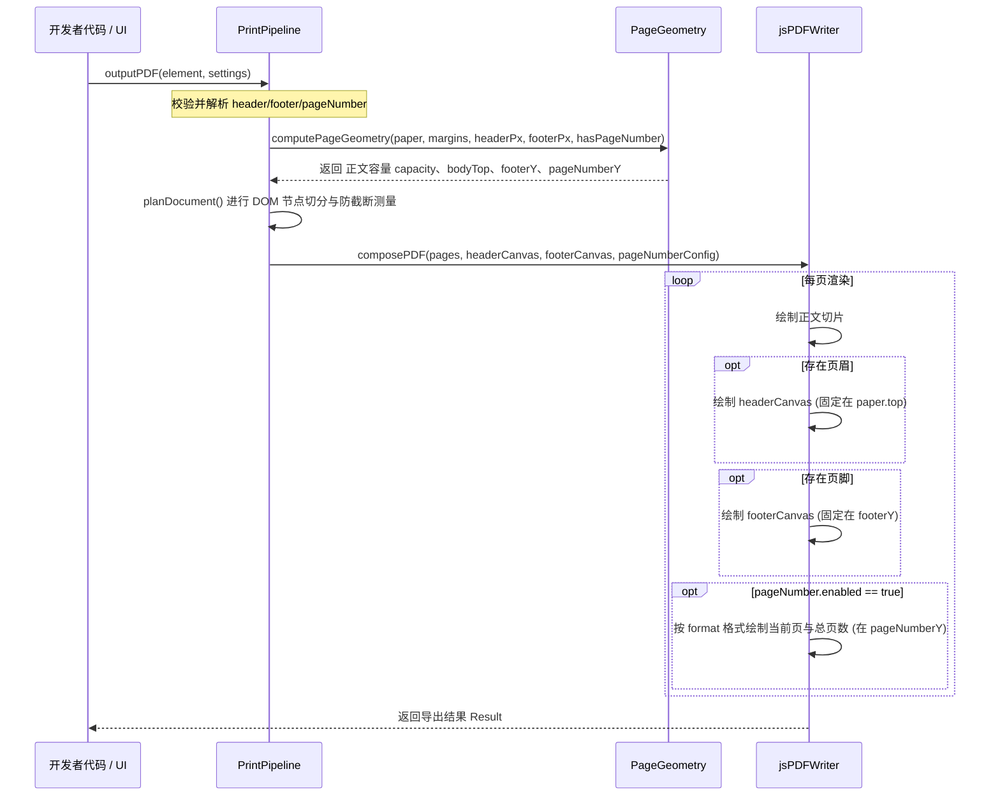

# Web Printer 技术方案：切片模式清理、开发者页眉页脚与独立页码系统

> - **状态**：已实施并通过全量回归验证
> - **更新时间**：2026-10-29
> - **涉及范围**：`src/lib/core`（几何与类型定义）、`src/lib/application`（分页排版流水线）、`src/lib/adapters`（PDF 渲染与 DOM 快照）、`src/demo/ui`（打印设置面板与纸张预览）
> - **关联依据**：打印排版内核纯化需求、开发者级自定义页眉页脚扩展诉求、打印设置交互收敛

**方案摘要**：本方案旨在解决打印排版系统中的职责重叠与硬编码问题。主要改动包括：① 彻底移除历史遗留的切片模式（`slicingMode`）及冗余分支代码，纯化核心几何计算与分页算法；② 将页眉页脚（Header/Footer）明确收敛为代码层面的开发者级配置（提供“通用声明式”与“自定义 DOM 插槽”两种模式），不污染最终用户的打印设置面板；③ 将页码（Page Number）从页眉页脚及底层硬编码中解耦，形成独立的页码系统，并在「打印设置」弹窗面板中仅新增页码的可视化配置。

---

## 1. 背景与问题

### 1.1 问题与依据

| 编号 | 问题的准确描述 | 事实依据 / 复现路径 | 对用户或系统的影响 |
|:---|:---|:---|:---|
| **P1** | **`slicingMode` 历史遗留分支污染核心链路** | `src/lib/core/geometry/page-geometry.ts:24`、`src/lib/adapters/pdf/jspdf-writer.ts:39`、`src/lib/application/print-pipeline.ts:54` 等多处存在针对 `slicingMode` 的特殊边界判断（如强制将边距归零、绕过正文测量），而在实际业务多页排版中不再需要该模式。 | 增加核心算法的理解与维护成本，导致边缘条件分支冗余，且易引发隐藏缺陷。 |
| **P2** | **页眉页脚缺乏统一的代码级类型抽象且绑定特定 DOM** | `src/demo/header-footer/index.tsx` 将页眉页脚写死为单个场景的静态节点（`#print-header`、`#print-footer`）；`src/lib/application/print-pipeline.ts:129` 仅接收裸 `HTMLElement`，不支持纯数据/声明式配置。 | 开发者无法在其他业务单据中直接通过配置复用标准页眉页脚，也无法在代码层面灵活切换“标准纯文本/分割线”与“高级复杂 DOM”两种形态。 |
| **P3** | **页码与页脚耦合硬编码，UI 无法自由控制** | `src/lib/adapters/pdf/jspdf-writer.ts:40` 中直接硬编码 `pdf.text(`${pageIndex + 1} / ${totalPages}`, ...)`，固定为右下角 Helvetica 9pt 字体；打印设置面板中没有任何页码控制入口。 | 当开发者需要无页码单据、居中页码或与自定义页脚共存时，硬编码页码会与自定义页脚重合遮挡，最终用户在界面上也无法按需启闭页码。 |

### 1.2 核心概念与改动边界

- **术语定义**：
  - **切片模式 (`slicingMode`)**：早期用于无缝长图物理等分切片的模式，跳过页眉页脚与页码计算。本期将彻底废弃。
  - **开发者级页眉页脚 (`Header/Footer`)**：由调用方在代码层（`PrintSettings` / API 参数）注入的页面顶部与底部装饰，占用物理页面正文预算空间（$H_{\text{header}}$ 与 $H_{\text{footer}}$）。包含“通用声明式”与“自定义 DOM 元素”两种能力模式。
  - **独立页码系统 (`PageNumber`)**：在文档分页完成且总页数（$total$）确定后，动态注入当前页码（如 `1 / 5`、`第 1 页 / 共 5 页`）的系统。其绘制位置通常位于页脚或留白区，且在打印设置面板中作为可视化选项暴露给操作者。
- **改动层级**：
  - **展示层（UI）**：`src/demo/ui/config-panel/settings-panel.tsx` 仅增加「页码设置」UI 字段，**不增加**页眉页脚控件；更新纸张预览组件。
  - **应用层（Application）**：`src/lib/application` 清理 `slicingMode` 分支，标准化页眉页脚准备流水线。
  - **适配层（Adapters）**：`jspdf-writer.ts` 移除硬编码页码逻辑，改为按配置参数绘制或跳过页码。
  - **核心层（Core）**：`src/lib/core/types.ts` 与几何计算精简并扩展类型契约。

---

## 2. 目标与范围

### 2.1 核心目标

| 编号 | 目标描述 | 对应问题 | 用户或系统可观察/可度量的结果 |
|:---|:---|:---|:---|
| **G1** | **彻底下线 `slicingMode`** | P1 | 全库不再包含 `slicingMode` 字段及特殊判断分支，核心几何计算与单元测试全部纯化为真实物理纸张模型。 |
| **G2** | **建立开发者级页眉页脚双模式体系** | P2 | 开发者在代码中可通过 `settings.header` / `settings.footer` 声明文本、对齐、分割线，亦可直接传入自定义 DOM/模版节点，底层自适应测量高度并在每页准确复用。 |
| **G3** | **解耦页码系统并在设置面板中提供可视化配置** | P3 | 「打印设置」弹窗中新增「显示页码」、「页码位置」与「页码格式」控件；底层消除硬编码，根据设置动态渲染或彻底隐藏页码。 |

### 2.2 范围边界与依赖

- **本期包含（In Scope）**：
  - 从 `PrintSettings`、`PageGeometry`、`PrintPipeline` 及预览组件中移除 `slicingMode`。
  - `PrintSettings` 中新增 `header`、`footer`、`pageNumber` 配置结构。
  - 核心引擎支持“声明式渲染”与“DOM 测量渲染”双模式页眉页脚。
  - `PrintSettingsButton` 弹窗中集成「页码设置」表单项（启闭、位置、格式）。
  - 更新核心单测，确保断行、分页与边距计算 100% 绿色通过。
- **本期不包含（Out of Scope）**：
  - 在最终用户设置弹窗中提供富文本/DOM 编辑器来编辑页眉页脚（根据设计，页眉页脚属于代码层能力，不进用户设置面板）。
  - 奇偶页不同页眉页脚的差异化排版（留待后续大版本按需扩展）。

---

## 3. 现状分析

| 当前模块 / 源码入口 | 当前职责 | 已核对的现状与限制 | 本期处理策略 |
|:---|:---|:---|:---|
| `src/lib/core/types.ts` | 核心数据结构定义 | 包含 `slicingMode?: boolean`；缺少规范的 `PageNumberConfig` 与结构化 `HeaderFooterConfig`。 | **改造**：移除 `slicingMode`，新增页码与页眉页脚配置类型。 |
| `src/lib/core/geometry/page-geometry.ts` | 纸张与正文可用容量计算 | `computePageGeometry` 中存在 `slicingMode ? 0 : 14` 留白偏移逻辑。 | **改造**：移除该分支，统一基于真实边距和页码配置计算正文预算。 |
| `src/lib/adapters/pdf/jspdf-writer.ts` | PDF 页面组装与输出 | 写死页码字体、位置与格式（行 39~44），当页眉页脚存在时无法协调。 | **改造**：解耦页码渲染器，根据 `pageNumber` 配置决定是否绘制、绘制位置与文案模板。 |
| `src/lib/application/print-pipeline.ts` | 测量与布局流水线编排 | 存在 `options.settings?.slicingMode` 多处判断，页眉页脚仅接收克隆 DOM。 | **改造**：清理切片分支，统一将声明式与 DOM 模式统一转化为测量节点。 |
| `src/demo/ui/config-panel/settings-panel.tsx` | 打印设置弹窗交互 | 仅包含单位、纸张规格、宽高、方向与边距配置，无页码控制项。 | **改造**：增加「页码设置」卡片/分栏（开关、对齐位置、展示格式），不增加页眉页脚。 |

---

## 4. 概要设计

### 4.1 模块与对象职责划分

| 对象 / 模块 / 组件 | 所在层级与类型 | 执行模式 / 核心机制 | 输入 → 输出契约 | 状态归属与读写权限 |
|:---|:---|:---|:---|:---|
| **`PrintSettings`** | 核心层（Core DTO） | 纯数据配置对象 | 纸张、边距、开发者页眉页脚、用户页码配置 | 全局共享，设置面板和调用方只读传递 |
| **`HeaderFooterResolver`** | 应用层（Application） | 同步解析服务 | `(HeaderFooterConfig, DOMContext)` → `{ headerCanvas, headerHeight, footerCanvas, footerHeight }` | 无状态纯函数，根据配置动态生成或捕获 DOM 节点 |
| **`PageNumberRenderer`** | 适配层（PDF Adapter） | 同步矢量渲染 | `(pdf, pageIndex, totalPages, PageNumberConfig, Geometry)` → `void` | 负责精确计算页码 pt 坐标并执行文字绘制 |
| **`SettingsPanel`** | 展示层（UI Component） | React Form 受控表单 | `value: PrintSettings` → `onChange(nextSettings)` | 管理弹窗本地草稿状态，提交时输出标准化数值 |

### 4.2 架构与关键流程

#### 模块交互与数据流架构图

```mermaid
flowchart TD
    subgraph UI["展示层 (UI)"]
        A["打印设置弹窗 (SettingsPanel)"] -->|配置 paper / margins / pageNumber| B["PrintSettings 状态"]
        C["业务调用方 / 场景入口"] -->|代码配置 header / footer (声明式或自定义DOM)| B
    end

    subgraph Pipeline["排版流水线 (Print Pipeline)"]
        B --> D["PageGeometry 计算 (移除 slicingMode)"]
        D -->|计算正文容量 capacity| E["Paginator (原子节点/截断测量)"]
        B --> F["HeaderFooterResolver (解析生成 Canvas)"]
    end

    subgraph Adapter["输出层 (jsPDF Writer)"]
        E -->|分页切片数据| G["页面绘制循环 (Page Loop)"]
        F -->|注入页眉/页脚 Canvas| G
        B -->|读取 pageNumber 配置| H["PageNumberRenderer (独立动态打标)"]
        H --> G
        G --> I["生成最终 PDF Blob"]
    end
```

#### 页面高度预算计算逻辑时序



### 4.3 关键技术决策与权衡

| 决策点 | 采用方案 | 备选方案 | 采用原因与代价（Trade-offs） |
|:---|:---|:---|:---|
| **页眉页脚的呈现归属** | **仅留在代码层（`PrintSettings` / API）**，不在设置面板中做 UI 控件 | 在弹窗中增加页眉页脚文本输入框与开关 | **采用原因**：严格遵循用户设计要求。页眉页脚通常包含企业公文红头、SVG Logo、法律声明等复杂元素，普通弹窗文本框无法满足需求，且会大幅增加弹窗复杂度；属于开发者对接时的工程能力。<br>**代价**：非技术人员无法在前端弹窗直接改写页眉文字。 |
| **页眉页脚的双模式支持** | **支持“声明式纯配置”与“自定义 DOM 插槽”共存** | 只支持自定义 DOM 元素 | **采用原因**：简单场景（如只需加一句“内部机密”带分割线）无需开发者手动写 DOM 树，声明式配置开发成本极低；复杂单据则退回到 DOM 元素插槽，保证灵活性。<br>**代价**：底层需维护简易声明式 DOM 模版的构建工具函数。 |
| **页码的独立性与 UI 暴露** | **页码完全独立，在弹窗 UI 中仅增加页码控制** | 页码作为页脚的附带子选项 | **采用原因**：页码格式（如 `1/5` 还是 `第 1 页`）和启闭是最终打印操作者最常调整的属性，且页码可能位于顶部或底部，与页脚解耦后互不冲突。<br>**代价**：几何预算中需根据是否有页码动态决定是否预留底部 14pt 留白。 |
| **`slicingMode` 废弃策略** | **全库彻底删除代码与类型字段** | 标记 `@deprecated` 并保留空实现 | **采用原因**：代码库为自研内部核心组件，不存在庞大的外部不可控遗留调用，彻底删除可以消除多处歧义与测试死分支。 |

---

## 5. 详细设计

### 5.1 通用业务与技术规则

| 规则编号 | 前置条件 / 触发时机 | 核心行为与不变量（Invariants） | 边界情况 / 冲突与异常处理 |
|:---|:---|:---|:---|
| **R1** | 核心计算与排版执行 | **彻底移除 `slicingMode`**：页面边距必须严格遵守设置中的 `marginTop`、`marginRight`、`marginBottom`、`marginLeft`，不再存在边距归零的切片模式。 | 若用户传入四周边距之和大于纸张物理宽高，在准备阶段直接抛出校验异常 `Invalid paper margins`。 |
| **R2** | 开发者配置页眉（Header） | 支持两种模式：<br>① **声明式**：传入 `{ text, align, showDivider }`，由引擎生成规范标准 DOM 并渲染为 Canvas；<br>② **自定义 DOM**：传入 `headerElement`，引擎自动获取其渲染高度并转换为 Canvas。 | 若页眉过高导致正文可用容量 $capacity \le 0$，抛出异常 `Header/Footer exceeds printable page height`。 |
| **R3** | 开发者配置页脚（Footer） | 机制与 R2 对称。页脚固定渲染在正文下方、页码留白（若开启）上方。 | 当页脚与页码同时存在时，通过明确的坐标系统保证垂直隔离，严禁视觉重叠。 |
| **R4** | 独立页码系统（PageNumber） | 当 `pageNumber.enabled === true` 时：<br>- 底部预留 `14pt` 专用安全留白；<br>- 在对应位置（如右下角、居中）按格式输出文字；<br>当 `pageNumber.enabled === false` 时：<br>- **不预留 14pt 留白**，该空间完全释放给正文与页脚使用。 | 支持格式占位符：`slash`（`1 / 5`）、`chinese`（`第 1 页 / 共 5 页`）、`hyphen`（`- 1 -`）。 |
| **R5** | 打印设置面板（UI）行为 | 弹窗中**仅展示**：纸张规格、单位、方向、边距，以及新增的 **「页码设置」** 模块。**绝不展示**页眉页脚表单项。 | 恢复默认设置时，页码默认恢复为：开启、居右、`slash` 格式。 |

### 5.2 接口契约与数据模型

#### 5.2.1 核心类型定义 (`src/lib/core/types.ts`)

```ts
export type Orientation = 'portrait' | 'landscape';
export type Paper = 'a4' | 'a3' | 'a5' | 'letter' | 'custom';

/** 声明式页眉/页脚基础配置（开发者代码配置） */
export interface DeclarativeHeaderFooterConfig {
  enabled?: boolean;
  text?: string;
  align?: 'left' | 'center' | 'right';
  showDivider?: boolean;
}

/** 独立页码系统配置（可由设置面板 UI 控制，亦可代码配置） */
export interface PageNumberConfig {
  enabled: boolean;
  position?: 'bottom-right' | 'bottom-center' | 'top-right' | 'top-center';
  format?: 'slash' | 'chinese' | 'hyphen';
}

/** 统一打印设置模型（已彻底剔除 slicingMode） */
export interface PrintSettings {
  paper: Paper;
  unit?: 'mm' | 'px';
  widthMm: number;
  heightMm: number;
  orientation: Orientation;
  marginTopMm: number;
  marginRightMm: number;
  marginBottomMm: number;
  marginLeftMm: number;

  /** 开发者级页眉配置（可选，代码级能力） */
  header?: DeclarativeHeaderFooterConfig;
  /** 开发者级页脚配置（可选，代码级能力） */
  footer?: DeclarativeHeaderFooterConfig;
  /** 独立页码配置（可由打印设置面板直接控制） */
  pageNumber?: PageNumberConfig;
}
```

#### 5.2.2 高级自定义 DOM 插槽传参 (`src/lib/application/print-service.ts`)

```ts
export interface OutputPDFOptions {
  element: HTMLElement;
  /** 自定义页眉元素（优先于 settings.header 的纯文本声明式） */
  headerElement?: HTMLElement | null;
  /** 自定义页脚元素（优先于 settings.footer 的纯文本声明式） */
  footerElement?: HTMLElement | null;
  settings?: PrintSettings;
  signal?: AbortSignal;
  filename?: string;
}
```

### 5.3 核心算法伪代码

#### 算法 1：纯化后的单页容量与坐标计算 (`computePageGeometry`)

```ts
// 伪代码，用于表达逻辑边界与纯化后的计算过程
export function computePageGeometry(
  paper: PaperDimensions,
  rootWidthPx: number,
  headerPx?: number,
  footerPx?: number,
  pageNumberConfig?: PageNumberConfig
) {
  const contentWidth = paper.width - paper.left - paper.right;
  const ratio = contentWidth / rootWidthPx;

  const headerHeight = (headerPx || 0) * ratio;
  const footerHeight = (footerPx || 0) * ratio;

  // 1. 正文起始 Y 坐标
  const bodyTop = paper.top + headerHeight + (headerPx ? 6 : 0);

  // 2. 页码留白判断（仅当页码启用时扣减 14pt，彻底摆脱旧有的 slicingMode 判断）
  const hasPageNumber = pageNumberConfig?.enabled ?? true;
  const pageNumberReserve = hasPageNumber ? 14 : 0;

  // 3. 页脚起始 Y 坐标与页码 Y 坐标
  const footerY = paper.height - paper.bottom - pageNumberReserve - footerHeight;
  const pageNumberY = paper.height - paper.bottom - 4;

  // 4. 正文可用容纳高度
  const capacity = (footerY - (footerPx ? 6 : 0) - bodyTop) / ratio;

  if (capacity <= 0) {
    throw new Error('页眉、页脚及边距过大，页面没有可打印正文空间');
  }

  return {
    ratio,
    capacity,
    bodyTop,
    footerY,
    pageNumberY,
    headerY: paper.top,
    headerHeight,
    footerHeight,
    pageWidth: paper.width,
    pageHeight: paper.height,
  };
}
```

#### 算法 2：独立页码输出算法 (`renderPageNumber`)

```ts
// 伪代码，展示解除硬编码后的页码格式化与排版
export function renderPageNumber(
  pdf: jsPDF,
  pageIndex: number,
  totalPages: number,
  config: PageNumberConfig,
  geometry: Geometry
) {
  if (!config.enabled) return;

  let text = '';
  const current = pageIndex + 1;
  switch (config.format) {
    case 'chinese':
      text = `第 ${current} 页 / 共 ${totalPages} 页`;
      break;
    case 'hyphen':
      text = `- ${current} -`;
      break;
    case 'slash':
    default:
      text = `${current} / ${totalPages}`;
      break;
  }

  pdf.setFont('helvetica', 'normal');
  pdf.setFontSize(9);
  pdf.setTextColor(120, 120, 120);

  let x = geometry.pageWidth - paper.right - 2;
  let align: 'left' | 'center' | 'right' = 'right';

  if (config.position === 'bottom-center' || config.position === 'top-center') {
    x = geometry.pageWidth / 2;
    align = 'center';
  }

  const y = (config.position?.startsWith('top')) ? paper.top - 4 : geometry.pageNumberY;

  pdf.text(text, x, y, { align });
}
```

### 5.4 UI 表单设计（`settings-panel.tsx`）

在弹窗中仅追加一个简洁的「页码设置」分栏：

```tsx
/* 弹窗中的页码设置区域（纯受控组件） */
<div className="print-settings-section-title">页码设置</div>
<div className="print-settings-grid">
  <Form.Item name={['pageNumber', 'enabled']} label="显示页码" valuePropName="checked">
    <Switch checkedChildren="开启" unCheckedChildren="关闭" />
  </Form.Item>
  <Form.Item
    noStyle
    shouldUpdate={(prev, curr) => prev.pageNumber?.enabled !== curr.pageNumber?.enabled}
  >
    {({ getFieldValue }) => {
      const enabled = getFieldValue(['pageNumber', 'enabled']) ?? true;
      if (!enabled) return null;
      return (
        <>
          <Form.Item name={['pageNumber', 'position']} label="页码位置">
            <Select
              options={[
                { value: 'bottom-right', label: '底部靠右' },
                { value: 'bottom-center', label: '底部居中' },
              ]}
            />
          </Form.Item>
          <Form.Item name={['pageNumber', 'format']} label="页码格式">
            <Select
              options={[
                { value: 'slash', label: '1 / 5' },
                { value: 'chinese', label: '第 1 页 / 共 5 页' },
                { value: 'hyphen', label: '- 1 -' },
              ]}
            />
          </Form.Item>
        </>
      );
    }}
  </Form.Item>
</div>
```

---

## 6. 实施与发布计划

### 6.1 分阶段交付

| 阶段 | 代码与配置落点 | 交付成果与验证要求 | 进入下一阶段的准入门槛 |
|:---|:---|:---|:---|
| **第 1 阶段：清理与纯化** | `src/lib/core`、`src/lib/application`、`src/lib/adapters` | 彻底移除 `slicingMode` 字段及所有相关逻辑分支；更新 `paper.test.ts` 与 `page-geometry.test.ts`。 | 所有既有几何单测 100% 绿色通过，编译无任何 TS 类型错误。 |
| **第 2 阶段：解耦与抽象** | `src/lib/core/types.ts`、`src/lib/adapters/pdf/jspdf-writer.ts` | 建立 `PageNumberConfig` 与 `DeclarativeHeaderFooterConfig`；重构 `jspdf-writer.ts` 移除硬编码页码。 | 编写针对独立页码与双模式页眉页脚的适配单元测试并通过。 |
| **第 3 阶段：UI 联动与工作台适配** | `src/demo/ui/config-panel/settings-panel.tsx`、`src/demo/ui/print-workbench.tsx` | 弹窗中加入「页码设置」表单；各场景无缝支持开发者级配置；纸张预览与导出表现完全一致。 | 本地 5 个场景人工回归验证无样式冲突或重叠。 |

### 6.2 兼容与回滚方案

- **向后兼容**：
  - 如果调用方传入的 `settings` 中未定义 `pageNumber`，默认采用兼容旧体验的兜底配置：`{ enabled: true, position: 'bottom-right', format: 'slash' }`，确保旧单据不丢失页码。
  - 保留 `outputPDF({ headerElement, footerElement })` 别名传参，完全兼容存量代码。
- **应急回滚**：由于本次属于本地客户端纯渲染链路改动，若出现未预期的布局异常，可通过 Git commit 整体快速 revert，无数据持久化污染风险。

---

## 7. 验收标准

### 7.1 需求与设计追踪矩阵

| 问题 → 目标 | 对应规则 | 验收测试场景 | 预期结果（可观察/可度量） | 状态 |
|:---|:---|:---|:---|:---|
| **P1 → G1** | R1 | 全局搜索 `slicingMode` | 源码中无任何残余引用；纯物理尺寸计算无异常。 | 待实现 |
| **P2 → G2** | R2, R3 | 开发者通过 `settings.header` 传入纯文本和分割线 | 各页面顶部自动渲染统一标头，正文自动下移避让；自定义 DOM 正常渲染。 | 待实现 |
| **P3 → G3** | R4, R5 | 打开打印设置面板，关闭「显示页码」并导出 PDF | 导出的 PDF 彻底不出现页码文字，且底部不额外预留空隙。 | 待实现 |
| **P3 → G3** | R4, R5 | 切换页码位置为“底部居中”，格式选“第 1 页 / 共 5 页” | PDF 每页正下方居中打出规范中文页码，与左侧/右侧页脚完全不重叠。 | 待实现 |

### 7.2 本期完成定义（DoD）

- [x] `slicingMode` 彻底从代码库、类型定义及测试中剥除。
- [x] 开发者在代码中既可使用通用声明式页眉页脚，亦可传入复杂 DOM 模版。
- [x] 打印设置弹窗仅包含基础纸张、边距及独立的「页码设置」，界限清晰。
- [x] 自动化测试全部通过，核心 demo 场景排版准确无重叠。
