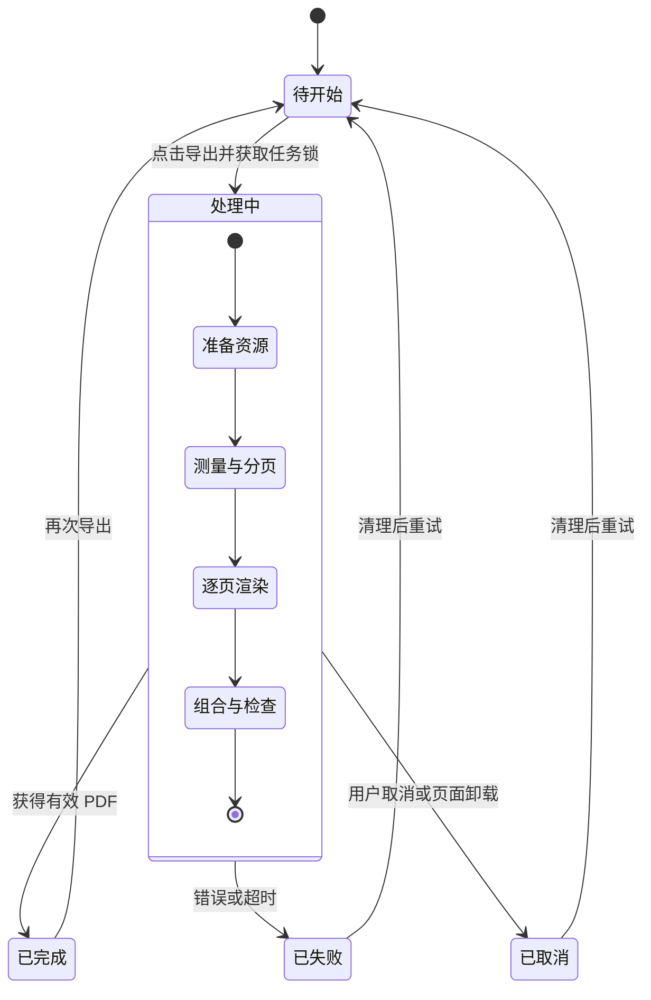
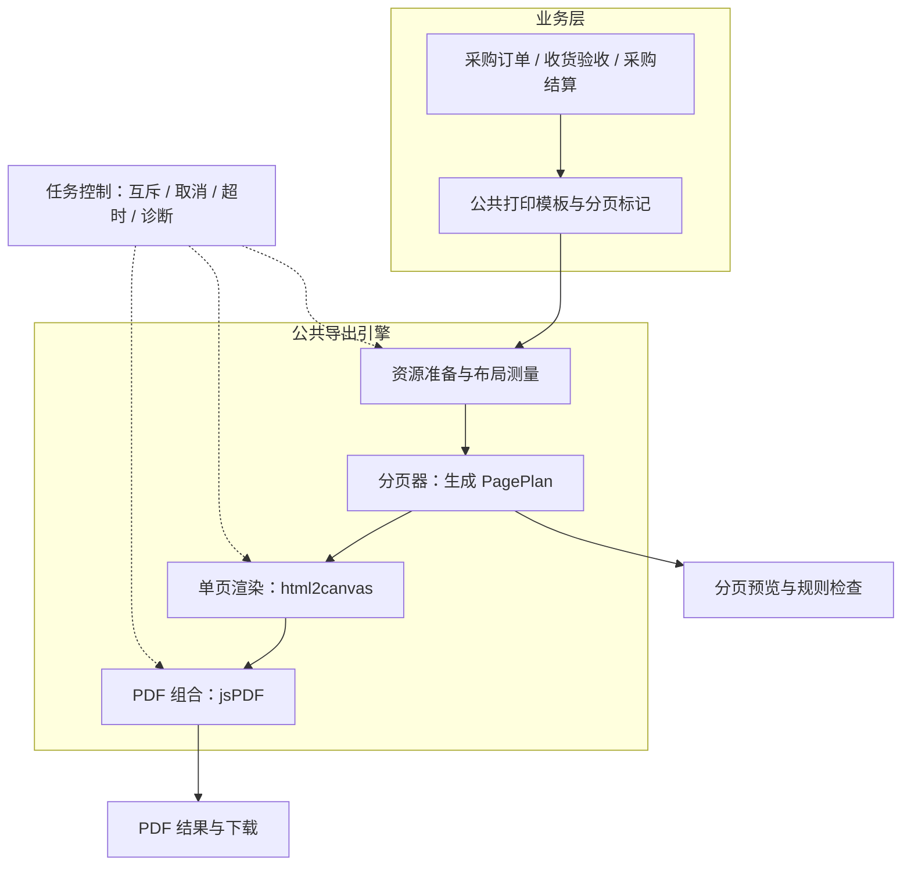
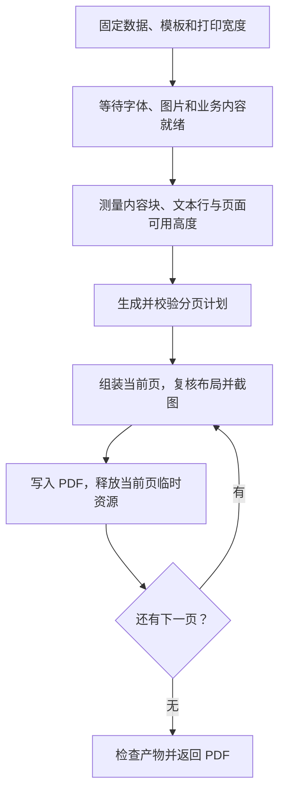

# 复杂页面 PDF 打印标准化技术方案

版本：V3 · 2026-10-28。基于当前项目，以下架构与治理措施为目标设计，尚未全部实现。

## 1. 业务目标与核心链路

采购、仓库和财务人员在后台查看对应的单据或报表，核对明细数据后，点击导出 PDF，用于后续核对、签认和归档。

**核心用户链路：进入后台 → 打开对应单据或报表 → 核对明细数据 → 点击导出 → 获取 PDF。**

标准化要解决两个问题：用户获得完整、可读、与所核对数据一致的 PDF；开发人员接入不同单据或报表时，复用同一套打印能力。

当前项目以采购订单、收货验收单和采购结算单为示例，覆盖多页表格、中英文长文本、签认区和附件，数据均为虚构。

| 用户步骤 | 系统责任 | 用户可见结果 |
| --- | --- | --- |
| 在后台打开单据或报表 | 加载并展示对应内容 | 看到待核对的单据与明细 |
| 核对明细数据 | 完整展示字段、明细及合计 | 确认需要导出的内容 |
| 点击导出 | 固定本次数据与模板，准备资源 | 进入处理中，阻止重复提交 |
| 获取 PDF | 完成分页、渲染和检查后交给浏览器下载 | 获得文件；失败时看到原因并可重试 |

## 2. 业务不变量

这些约束决定分页规则和失败策略，也是验收依据。

| 不变量 | 对应设计 |
| --- | --- |
| 同一份 PDF 使用同一版本的数据 | 导出开始时固定数据和打印视图，重试继续使用该快照 |
| 明细、金额和文本不丢失、不重复、不改写 | 每个正文片段恰好分配一次；导出层不承担业务计算 |
| 单据可读，关键内容完整 | 普通表格行整体换页，长文按文字行拆分，签认区整体保留；超高块明确处理 |
| 每页能辨认上下文 | 表头跨页重复，页眉页脚预留空间，页码与总页数正确 |
| 不完整产物不能当作成功结果 | 关键图片或字体缺失、分页无法完成时终止，不下载半成品 |
| 同一操作只交付一次有效结果 | 单活动任务；取消、失败及过期任务禁止触发下载 |

## 3. 技术选型调研与结论

选型路径：**业务不变量 → 交付与环境约束 → 候选方案比较 → 代表单据验证 → 技术路线。** 不变量约束结果，不能单独证明某个技术组合最优。

### 3.1 交付与环境约束

| 条件 | 当前依据与判断 |
| --- | --- |
| 后台单据导出 PDF | 用户已明确的核心链路 |
| 复用现有页面组件和样式 | 当前为 React＋AntD 页面，希望减少各单据重复开发 |
| 点击后直接下载，不经过打印对话框 | 当前下载函数体现该方向；作为本方案交付假设，尚不能视为已确认的硬要求 |
| 在前端本地完成，不新增 PDF 服务 | 当前工程为前端项目；本轮优先沿用，属于实施约束而非业务不变量 |
| 允许正文图片化，文档规模受控 | 截图路线成立的前提；搜索复制要求和容量上限尚需明确 |

### 3.2 候选方案比较

| 方案 | 如何满足业务目标 | 主要取舍 | 本项目判断 |
| --- | --- | --- | --- |
| 原生打印＋CSS | 用打印样式、分页属性和浏览器排版生成可打印文档 | `window.print()` 打开打印对话框；无需自建截图分页，但布局和输出设置需验证 | 若接受打印对话框，应优先验证，不能以“无法分页”为由排除 |
| html2canvas＋jsPDF＋JS 分页 | 复用打印 DOM，按业务规则规划页面，转为图像后组合下载 | 可控制交付和分页计划；正文图片化，存在 CSS、跨域和 Canvas 容量限制 | 在当前实施约束下作为重构主路线 |
| 结构化数据绘制 PDF | 根据字段、表格和段落直接排版，生成文本与图形 | 可保留文本；需要独立维护布局和字体，难直接复用 AntD 页面样式 | 固定报表或需要搜索复制时优先评估 |
| 服务端 Chromium＋打印 CSS | 服务端浏览器加载模板并生成 PDF，统一运行环境 | 支持程序化生成，通常保留文本；增加部署、鉴权、资源和任务治理 | 批量生成、大文档或统一输出环境需求明确后评估 |

CSS 是排版手段，可用于原生打印、服务端浏览器和专用打印模板；它与 JS 并非互斥选项。是否自建 JS 分页，取决于浏览器分页能否满足代表单据的规则与预览要求。

### 3.3 代表单据验证

用同一份数据和约束对比候选路线，至少验证以下样例：

| 样例 | 验证重点 |
| --- | --- |
| 采购订单：长表格＋中英文条款 | 明细无漏重、表头重复、文字不断行截断 |
| 收货验收单：长说明＋签认区＋附件 | 内容完整、签认区不拆、必要图片缺失时能识别 |
| 采购结算单：合计＋页眉页脚 | 金额一致、页码正确、正文与装饰不重叠 |

记录最终 PDF 的内容与分页结果、用户操作步骤、模板适配工作量、耗时和文件大小；再增加长文档阶梯样例确定容量边界。**当前只完成代码与官方能力调研，尚未完成候选方案的同样例实测，因此没有性能优胜结论。**

### 3.4 选型结论

本轮建议保留 **html2canvas＋jsPDF＋JavaScript 动态分页** 作为当前项目的重构主路线：在前端本地生成 PDF，复用现有打印视图，由 JS 生成可检查的分页计划，由 html2canvas 渲染单页，由 jsPDF 组合并交付文件。三者分别负责分页、图像渲染和 PDF 输出。

该结论基于当前工程及上述交付假设，是待样例验证的工程选择。若接受打印对话框且打印 CSS 已能满足规则，可简化为原生打印；若要求正文搜索复制，应优先比较结构化 PDF 与浏览器生成；若规模超出前端预算，再评估服务端路线。资源快照、任务控制和错误处理仍需应用层实现，选用这套库不会自动保证业务不变量。

调研依据：[原生打印行为](https://developer.mozilla.org/en-US/docs/Web/API/Window/print)、[CSS 分页规则](https://developer.mozilla.org/en-US/docs/Web/CSS/Reference/Properties/break-inside)、[html2canvas 渲染边界](https://html2canvas.hertzen.com/documentation)、[Canvas 限制](https://html2canvas.hertzen.com/faq/)、[Puppeteer PDF 生成](https://pptr.dev/api/puppeteer.page.pdf)。

## 4. 系统状态

状态用于控制按钮、进度、取消和结果交付；业务单据本身的状态不因导出改变。

只有“已完成且仍为当前任务”的结果可以下载。所有结束路径都清理临时资源并释放任务锁。取消在阶段或页面之间生效，在途 html2canvas 调用返回后丢弃结果，不能承诺立即中断。

## 5. 系统架构

保留 React、TypeScript、Ant Design、html2canvas 和 jsPDF。业务层提供完整打印视图及规则，公共引擎处理分页和导出；任务控制贯穿全程。

三个关键职责：**模板决定内容及规则，分页器决定每页放什么，渲染器负责把计划变成 PDF。** 预览与导出共享 PagePlan，避免两套分页规则不一致。

PagePlan 记录每页包含的内容片段、文本范围、重复表头和断点原因。它使分页可测试，也能解释为什么某一块被移到下一页。

正文沿用图片方式输出，适合复用页面视觉；如需正文搜索、复制或后台海量报表，应另评估结构化 PDF 或服务端生成。

## 6. 渲染与分页链路

| 关键设计 | 处理方式 |
| --- | --- |
| 稳定布局 | 在固定宽度打印快照中准备、测量和渲染，避免页面异步变化导致断点错位 |
| 页面预算 | 正文高度＝纸张高度－边距－页眉页脚及间距；测量用 CSS px，PDF 使用 pt，截图倍率只影响清晰度 |
| 表格与卡片 | 普通行、签认区放不下则整体移到下一页；重复表头占用新页预算；超过整页高度时按明确策略处理或拒绝 |
| 长文本 | 按实际文字行生成片段，处理中英文与内联样式；不用固定像素步长递归 |
| 分页收束 | 每轮必须推进内容游标，最后检查内容起点到终点全部覆盖，防止死循环和漏尾页 |
| 长文档 | 先分页，再按页组装和渲染，限制像素与页数；完整测量 DOM 和 PDF 缓冲仍会随规模增长 |

按页组装可能改变列宽、边距或样式，因此截图前要复核布局；不能只裁剪整篇 DOM 就认为已解决长文档性能问题。首版限定普通文档流和可适配表格，跨页合并单元格等特殊布局先明确拒绝。

## 7. 故障模型与工程治理

| 故障 | 破坏的约束 | 解决策略 |
| --- | --- | --- |
| 导出期间数据或布局变化 | 同一版本、内容完整 | 固定快照；资源就绪后统一测量和渲染 |
| 图片、签章或字体加载失败 | 单据完整、可读 | 必要资源失败即终止；可选资源按模板占位并警告；临时加载故障最多重试一次 |
| 长段落、超高行或不支持布局 | 合法分页 | 文字按行拆分；不可拆块超高时明确拒绝；分页无进展立即报错 |
| 文档过大、Canvas 分配失败 | 可用性 | 渲染前做页数与像素预算检查，逐页释放资源，禁止无限缩小正文 |
| 重复点击、切换页面或取消 | 只交付一次有效结果 | 任务锁＋任务 ID；检查结果是否过期；取消后禁止下载 |
| 超时或 PDF 组合异常 | 不交付半成品、可恢复 | 结束任务，丢弃不完整结果，统一清理，显示原因并允许重新导出 |
| 问题难复现 | 可定位、可修复 | 记录阶段、页码、耗时、错误码、模板版本与断点原因，默认不记录财务正文 |

稳定性验收直接围绕上述约束：核心单据检查内容无漏重；断点样例检查长文、表格、签认区及尾页；故障注入检查资源失败、取消和重复操作；最终 PDF 检查页数、尺寸和实际页图。性能用固定设备上的耗时、文件大小与资源趋势确定上限，不预填未经实测的提升比例。

## 8. 当前项目落地顺序

| 顺序 | 当前依据 | 下一步 |
| --- | --- | --- |
| 先恢复正确导出 | `index.tsx` 导出调用被注释；`pdf-print.ts` 页眉页脚数据反置、尾页补齐未调用 | 修复真实链路，分离调试入口，补缺陷回归 |
| 再统一分页模型 | 当前依赖 `ant4-table-row` 类名，段落按固定步长递归；调试另用 300px 页高 | 建立语义规则、文本行分页和共享 PagePlan |
| 最后补齐可靠性 | 当前先整页截图，缺少完整任务和资源治理 | 按页渲染、容量预算、状态控制、故障测试与 PDF 产物验收 |

代码依据：`src/pdf-demo/index.tsx`、`pdf-print.ts`、`pages-debug.ts` 和 `pages/business-demo.tsx`。上一轮类型检查与现有测试通过，但测试只覆盖业务 Tab 和部分数据，尚无真实 PDF 正确性与性能结论。本次仅精简技术方案，未修改业务实现。

> **路径说明**：上文的 `src/pdf-demo/*` 为本文撰写时的历史目录结构，该目录已被后续重构取代。当前库源码位于 `src/lib/`（`core` / `adapters` / `application` / `hooks` / `overlay`），示例工程位于 `src/demo/`（含 `src/demo/ui/`）。本节保留原文路径以维持历史记录的准确性，不作为当前代码位置指引。
