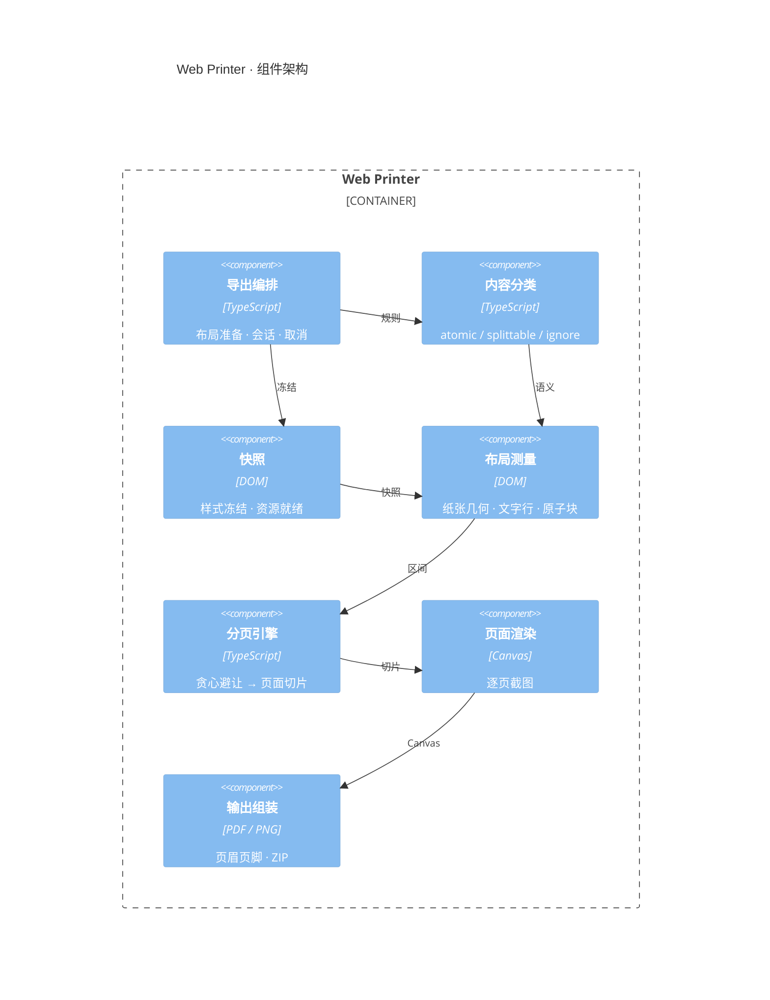

<p align="center">
  
</p>

浏览器内的 HTML 分页引擎：保留现有样式，输出 PDF 或逐页 PNG。

[在线工作台](https://pdf-demo-phi.vercel.app/#/playground) · [npm](https://www.npmjs.com/package/@darialan/web-printer) · [接入指南](https://github.com/darialan/web-printer/blob/master/docs/npm-package-guide.md)

[特性](#特性) · [安装](#安装) · [快速开始](#快速开始) · [架构](#架构) · [API](#api) · [仓库结构](#仓库结构) · [开发](#开发) · [文档](#文档)

<p align="center">
  
</p>

工作台在真实页面上标出 `atomic` 区间与分页状态，右侧是同一份布局生成的纸张预览。

## 特性

- **按内容分页**：文字按行测量，表格优先按行换页，图片、代码块和公式整块保护，不会被拦腰截断。
- **一套布局，两种输出**：PDF 单文件，或逐页 PNG 打包 ZIP；两种格式共用同一份分页结果。
- **纯浏览器执行**：不需要服务端 PDF 服务，适合报表、单据、合同和长文章导出。
- **不污染源页面**：测量和截图都在离屏快照里完成，导出前后源 DOM 的样式与内容不变。
- **可控的导出过程**：支持 `AbortSignal` 取消、逐页进度、缩略图预览和分页检查。
- **TypeScript 优先**：类型随包提供，核心入口无 React 依赖。

## 安装

```sh
npm install @darialan/web-printer
```

## 快速开始

```ts
import { outputDocument } from '@darialan/web-printer';

await outputDocument({
  element: document.getElementById('report')!,
  filename: 'report',
  format: 'pdf', // 'png'：逐页 PNG，打包为 ZIP
});
```

`download: false` 只返回 Blob；`signal` 取消导出；`onProgress(completed, total)` 报告页进度。返回 `{ blob, pages, bytes, layoutMs, totalMs }`。

## 架构

DOM 先被降维成受保护区间，再由纯函数算出分页计划，最后逐页执行截图。库由 7 个模块协作完成这条链路。



| 模块 | 职责 |
| --- | --- |
| 导出编排 | 对外 API；准备布局，管理会话、取消与资源释放 |
| 内容分类 | 判定 `atomic` / `splittable` / `ignore` |
| 快照 | 克隆源 DOM、冻结计算样式、等待字体与图片 |
| 布局测量 | 纸张几何、正文容量、文字行与原子块区间 |
| 分页引擎 | 纯函数：受保护区间 + 容量 → 页面切片 |
| 页面渲染 | 按切片逐页截图，复用同一份快照 |
| 输出组装 | 页眉页脚与页码 → PDF；逐页 PNG → ZIP |

测量与渲染复用**同一份快照**，避免“预览能看、导出不一样”。

## API

### 导出

| 参数 | 说明 |
| --- | --- |
| `element` | 打印区域；同源 `<iframe>` 可直接传入 |
| `format` | `'pdf'`（默认）或 `'png'` |
| `download` | 默认 `true`；`false` 时只返回 Blob |
| `settings` | 纸张、方向、边距、页眉页脚、页码；默认 A4 纵向、四边 10mm |
| `header` / `footer` | 每页重复渲染的独立 DOM 元素 |
| `onProgress` | `(completed, total) => void`，每页完成后回调 |
| `maxPages` | 默认 100，超出直接报错 |
| `rules` / `ruleConfig` | 覆盖或追加分页规则 |
| `signal` | `AbortSignal`，页面之间检查取消 |

返回 `{ blob, pages, bytes, layoutMs, totalMs }`。只导出 PDF 时也可以用 `outputPDF()`。

### 内容保护

在 HTML 上直接标记，不绑定框架或组件库：

```html
<article data-print-splittable="true">长文章正文</article>
<figure data-print-atomic="true">整块保护的配图与说明</figure>
<div data-print-ignore="true">不参与导出的工具栏</div>
```

- `data-print-atomic="true"` / `.print-atomic`：整块换页；单块超过一页时明确报错
- `data-print-splittable="true"` / `.print-splittable`：允许按文字行或子元素分割
- `data-print-ignore="true"` / `.print-ignore`：从导出中排除，不占用纸张空间
- `data-print-keep-together="split"` / `.print-keep-or-split`：优先整块换页，过高时降级拆分；表格行默认采用此规则

也可以不修改模板，用 `ruleConfig` 或 `configurePrint()` 注册选择器。

### 预览与检查

| API | 用途 |
| --- | --- |
| `createPrintSession(options)` | 冻结一次布局，供 `thumbnail(index)`、`exportDocument()` 复用；用完调用 `dispose()` |
| `inspectPrintLayout({ contentElement, ...options })` | 只测量与检查，返回页数、断点、受保护区间和耗时 |
| `calculatePagesArray(options)` | 只返回分页断点数组 |
| `configurePrint(config)` / `resetPrintRules()` | 全局注册或重置规则选择器 |
| `visualizePageBreaks(pages, element)` / `clearPageBreaks()` | 在源页面绘制或清理分页线 |

### React

```tsx
import { useRef } from 'react';
import { useWebPrinter } from '@darialan/web-printer/react';

export function Report() {
  const content = useRef<HTMLDivElement>(null);
  const { exportDocument, isExporting, progress, error, cancel } = useWebPrinter();

  return (
    <>
      <button
        disabled={isExporting}
        onClick={() =>
          exportDocument({
            element: content.current,
            filename: 'report',
            format: 'pdf',
          }).catch(() => {})
        }
      >
        {isExporting ? `导出中 ${progress.percent}%` : '导出 PDF'}
      </button>
      {isExporting && <button onClick={cancel}>取消</button>}
      {error && <p role="alert">{error.message}</p>}
      <div ref={content}>页面内容</div>
    </>
  );
}
```

在 Next.js App Router 中，请在客户端组件（`'use client'`）里调用。

## 仓库结构

<details>
<summary>展开目录</summary>

```text
src/lib/
├── core/          # 纯计算：分页、几何、规则
├── adapters/      # DOM 测量、快照、Canvas 截图、jsPDF
├── application/   # 流水线、导出服务、打印会话、取消
├── output/        # PDF / PNG writer、ZIP、页码
├── hooks/         # React 集成（仅 /react 入口）
└── overlay/       # 分页线可视化调试
src/demo/          # 工作台示例
src/landing/       # 落地页
e2e/               # Playwright 端到端用例
docs/              # 对外文档
assets/readme/     # README 视觉资产
```

</details>

## 依赖与运行环境

- 无服务端依赖：分页、截图与组装全部在浏览器内完成。
- 可选 React 16.8+：仅 `/react` 入口使用。
- 现代浏览器：需要 Canvas 2D、Range 与 Font Loading API。

## 开发

```sh
npm ci
npm start            # 本地工作台
npm run check        # 类型检查 + npm 包单测
npm run check:full   # 单测 + 库/站点构建 + 浏览器 e2e
```

约定：`src/lib/core` 保持纯计算；依赖方向为 `demo / ui → application → adapters + core`，不要反向 import。提交前钩子、源码细节与文档维护约定见 [CONTRIBUTING.md](https://github.com/darialan/web-printer/blob/master/CONTRIBUTING.md)。

## 文档

- [接入指南](https://github.com/darialan/web-printer/blob/master/docs/npm-package-guide.md)：参数、规则、框架集成与实现原理
- [输出层说明](https://github.com/darialan/web-printer/blob/master/docs/output-formats.md)：PDF / PNG writer 与失败语义

## License

MIT © darialan
