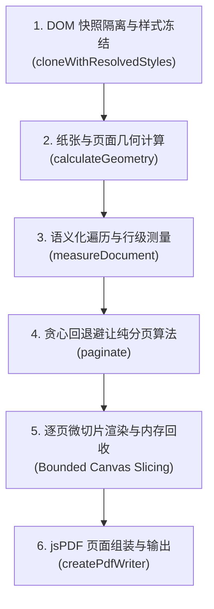

# @darialan/web-pdf-printer

> **WebPDF Printer**：高性能客户端 DOM 分页与 PDF 导出引擎。完美解决前端打印/导出 PDF 时的**文字被腰斩横切**、**表格行被跨页拆分**、**容器外样式走样**与**超长文档 Canvas 内存爆仓**等业界经典难题。

[](https://www.npmjs.com/)
[](https://www.typescriptlang.org/)
[](https://opensource.org/licenses/MIT)

---

## 🌟 核心特性

- ✂️ **智能避让分页算法**：基于 `Range.getClientRects()` 进行行级文字测量与原子保护区避让，彻底杜绝单行文字或表格行被横向切断半截。
- 🛡️ **计算样式全量冻结**：克隆 DOM 时深度冻结 `getComputedStyle`，脱离原始父级、Tab 或滚动容器也能保持 100% 像素级对齐。
- ⚡ **按页微切片渲染（Bounded Canvas Slicing）**：杜绝一次性绘制几十米长图导致的浏览器 Canvas 内存暴跌崩溃（OOM）。每一页渲染写入 PDF 后立即执行像素释放与内存回收。
- 📐 **高精度纸张几何换算**：支持 A4、A3、A5、Letter 及自定义纸张尺寸，内建 `pt`、`mm`、`px` 精准转换，自动扣减页眉、页脚与页边距。
- 🏷️ **语义化标记协议**：提供 `data-pdf-atomic`、`data-pdf-splittable`、`data-pdf-ignore` 声明式属性，无需写复杂配置即可定制分页行为。
- 🔍 **可视化辅助标线**：内置 `visualizePageBreaks` 调试工具，可在页面实时绘制分页切割线和元素类型标签（Atomic / Splittable / Ignore）。
- ⚛️ **框架无关 + React 开箱即用**：核心引擎为纯 TypeScript，适用于 Vanilla JS、Vue、Angular、React；同时内置 `usePdfPrint` React Hook。

---

## 📦 安装

```bash
npm install @darialan/web-pdf-printer html2canvas jspdf
# 或者
yarn add @darialan/web-pdf-printer html2canvas jspdf
# 或者
pnpm add @darialan/web-pdf-printer html2canvas jspdf
```

> **说明**：`html2canvas` 和 `jspdf` 为对等依赖（Peer Dependencies），需要安装在项目中。如果使用 React Hook，需确保项目安装了 `react` (>=16.8.0)。

---

## 🚀 极速上手

### 1. 原生 JS / Vue / 通用用法

```ts
import { outputPDF } from '@darialan/web-pdf-printer';

// 获取待打印的 DOM 容器
const printElement = document.getElementById('my-print-area');

// 一键导出并触发浏览器下载
await outputPDF({
  element: printElement,
  filename: '采购对账单.pdf',
  settings: {
    paper: 'a4',
    orientation: 'portrait',
    marginTopMm: 10,
    marginRightMm: 10,
    marginBottomMm: 10,
    marginLeftMm: 10,
  },
  onProgress: (current, total) => {
    console.log(`正在导出第 ${current} / ${total} 页...`);
  },
});
```

### 2. React Hook 用法 (`usePdfPrint`)

```tsx
import React, { useRef } from 'react';
import { usePdfPrint } from '@darialan/web-pdf-printer';

export function InvoicePage() {
  const contentRef = useRef<HTMLDivElement>(null);
  const { isPrinting, progress, exportPDF } = usePdfPrint();

  const handleExport = async () => {
    if (!contentRef.current) return;
    await exportPDF({
      element: contentRef.current,
      filename: '销售发票.pdf',
    });
  };

  return (
    <div>
      <button onClick={handleExport} disabled={isPrinting}>
        {isPrinting ? `导出中 (${progress.percent}%)...` : '导出 PDF'}
      </button>

      <div ref={contentRef} style={{ background: '#fff', padding: 24 }}>
        <h1>销售发票</h1>
        <p>明细内容与表格...</p>
      </div>
    </div>
  );
}
```

---

## 🏷️ HTML 声明式标记协议

你可以通过在 HTML 元素上添加 `data-pdf-*` 属性或对应的 CSS 类名，直接指导分页引擎：

| 属性 / Class | 语义 | 分页处理规则 | 典型应用场景 |
| --- | --- | --- | --- |
| `data-pdf-atomic="true"`<br/>`.pdf-atomic` | **原子不可分割** | 绝对禁止内部切割。如果当前页剩余高度放不下，整块平移至下一页开头。 | 签字盖章栏、卡片、图表、合同条款块 |
| `data-pdf-splittable="true"`<br/>`.pdf-splittable` | **流式容器** | 允许分页线穿透内部。引擎会继续深入测量其子元素或文本行。 | 长文章容器、流式介绍段落 |
| `data-pdf-ignore="true"`<br/>`.pdf-ignore` | **忽略元素** | 导出时完全排除在 PDF 之外，不参与高度计算与渲染。 | 页面上的导出按钮、分页器、调试工具 |
| `data-pdf-keep-together="split"`<br/>`tr` 元素 | **行级复合块** | 优先整块推移；若单行高度本身超出单页纸张极限，则允许拆分。 | 表格数据行、带有小图的列表项 |

> **提示**：引擎已内置了大部分原生标签的合理默认规则：`h1~h6`、`img`、`canvas`、`svg`、`tr` 默认作为原子项保护；`script`、`style`、`[hidden]` 默认忽略。

---

## 🧩 核心底层原理深度剖析

传统前端 DOM 导出 PDF 往往采用 `window.print()` 或 naive 的 `html2canvas(element).then(canvas => jsPDF.addImage(canvas))`。这两种方式在面对复杂企业级单据（多页表格、图文混排、电子签章）时存在天然缺陷：

```
[Naive 全量截图]   超长 DOM ──> 几万像素超大 Canvas ──> 浏览器 OOM 内存崩溃或白屏
[物理硬切]         直接按页面高度截断 ──> 文字正好在切线上被截成两半、表格行被腰斩
[上下文丢失]       没有页眉页脚、没有动态页码、脱离 Tab 容器后样式坍塌
```

`@darialan/web-pdf-printer` 采用了 **五阶段流水线架构**：



### 1. DOM 隔离克隆与计算样式冻结 (Style Freezing)
- **问题**：如果直接在页面原始 DOM 上操作，会受到当前滚动条、Tab 切换、弹窗隐藏或 Flex/Grid 弹性宽度的影响；若直接 `cloneNode(true)`，克隆节点脱离原有 CSS 上下文后会出现字体变小、行高错位、输入框内容丢失等问题。
- **解法**：
  1. 调用 `cloneWithResolvedStyles`，深度同步目标节点与克隆节点的 `window.getComputedStyle(source)`。
  2. 针对 `input`、`textarea`、`select`、`canvas` 显式同步运行时值与图层位图。
  3. 过滤并锁定外层根宽度（`getBoundingClientRect().width`），避免脱离文档流后的自动收缩（shrink-wrap）。
  4. 挂载在离屏沙箱 (`position: absolute; left: -100000px`)，并调用 `waitForResources` 等待所有 `` 与 `document.fonts.ready` 加载完毕。

### 2. 纸张与页面几何模型 (Page Geometry)
- **多单位精准换算**：
  $$\text{1 英寸} = 25.4\text{ mm} = 96\text{ CSS px} = 72\text{ PDF pt}$$
- **容量扣减**：
  根据纸张方向（横向/纵向）与边距，扣减页眉、页脚及底部页码槽位，计算出页面正文最大可容纳 CSS 像素高度：
  $$\text{capacity} = \frac{\text{PageHeightPt} - \text{MarginTopPt} - \text{MarginBottomPt} - \text{HeaderPt} - \text{FooterPt}}{\text{ScaleRatio}}$$

### 3. 语义遍历与行级测量 (DOM Measurement)
- **文本行精准切割**：
  对于段落与文本节点，引擎不会把整个段落当成不可分割的黑盒，而是创建 `document.createRange()`，调用 `range.getClientRects()`，获取该文本在每一行上的实际包围盒，提取出每个文字行的 $[top, bottom]$ 物理区间。
- **原子保护区标记**：
  表格行（`tr`）、图片、标题和带有 `data-pdf-atomic` 的节点，其包围盒整体注册为受保护的区间 $[top_i, bottom_i]$。

### 4. 贪心回退避让纯分页算法 (Avoidance Pagination)
- **纯函数、零副作用**：算法输入仅为 `height`（总高）、`capacity`（单页容量）和 `protectedRanges`（受保护区间数组）。
- **回退机制**：
  1. 初始尝试切片窗口：$[start, start + capacity]$。
  2. 检查是否有受保护区间跨越切点（即 $top_k < end < bottom_k$）。
  3. 若有元素被切断，切点 $end$ 立即向前回退至该元素的顶部 $top_k$。
  4. 递归检查前移后的新切点，直至切线位于完全空白的安全缝隙中。
  5. 记录切片 $[start, end]$，下一页从 $end$ 开始继续计算。

```
单页容量上限 ───────────┐
                      │ 💥 原始切线切中了表格第二行
 ┌──────────────────┐ │
 │ 采购明细表格行 1 │ │
 ├──────────────────┤ │
 │ 采购明细表格行 2 │─┴─ ✁ Naive 切点 (腰斩)
 ├──────────────────┤
 │                  │ ➔ 算法自动将切线回退至行 2 的顶部！
 └──────────────────┘   整行平移至第二页，确保零瑕疵。
```

### 5. 逐页微切片渲染与内存回收 (Bounded Canvas Slicing)
- **内存安全**：
  彻底废弃“整页一次性截图”的陈旧做法。通过调用 `html2canvas(element, { y: page.start, height: page.end - page.start })`，每次只截取单页正文微片。
- **瞬时销毁**：
  单页 Canvas 写入 `jsPDF` 后，立即执行 `canvas.width = 0; canvas.height = 0;` 清空像素缓冲区，让浏览器垃圾回收器随时回收显存，支持成百上千页的大型报表导出。

---

## 🛠️ API 完整参考

### `outputPDF(options: ExportOptions): Promise<ExportResult>`

主导出函数。将 DOM 元素测量、分页、按页渲染并组合为 PDF，支持直接下载或返回 Blob。

#### `ExportOptions` 参数说明：

| 参数名 | 类型 | 必填 | 默认值 | 描述 |
| --- | --- | --- | --- | --- |
| `element` | `HTMLElement` | 是 | - | 待打印的目标根 DOM 节点 |
| `filename` | `string` | 是 | - | 导出的 PDF 文件名（如 `'report.pdf'`） |
| `download` | `boolean` | 否 | `true` | 是否在生成后自动触发浏览器下载 |
| `header` | `HTMLElement` | 否 | - | 每页固定重复的页眉 DOM 元素 |
| `footer` | `HTMLElement` | 否 | - | 每页固定重复的页脚 DOM 元素 |
| `settings` | `PrintSettings` | 否 | A4 纵向 | 纸张与边距配置项 |
| `signal` | `AbortSignal` | 否 | - | 用于取消导出的 AbortSignal |
| `ruleConfig`| `PrintRuleConfig`| 否 | - | 自定义原子/忽略/可分割选择器规则 |
| `onProgress`| `(completed, total) => void` | 否 | - | 页面导出进度回调 |

#### `PrintSettings` 结构：

```ts
export interface PrintSettings {
  paper: 'a4' | 'a3' | 'a5' | 'letter' | 'custom';
  orientation: 'portrait' | 'landscape';
  marginTopMm: number;
  marginRightMm: number;
  marginBottomMm: number;
  marginLeftMm: number;
  // 自定义尺寸 (当 paper 为 'custom' 时生效)
  widthMm?: number;
  heightMm?: number;
  slicingMode?: boolean; // 是否启用纯物理切片模式（跳过避让）
}
```

---

### `inspectPrintLayout(options): Promise<PrintInspectionResult>`

布局诊断与测量函数。不生成 PDF，用于预览分页位置、检测冲突与排查布局问题。

```ts
import { inspectPrintLayout } from '@darialan/web-pdf-printer';

const result = await inspectPrintLayout({
  contentElement: document.getElementById('report'),
});

console.log('预测总页数:', result.pages.length);
console.log('分页切割点 (px):', result.pageBreaks);
console.log('测量耗时 (ms):', result.timing.measurementMs);
```

---

### `visualizePageBreaks(pageBreaks: number[], element: HTMLElement)`

在真实页面上渲染可视化的分页指示线与节点语义指示徽标（Atomic 为红色实线，Splittable 为蓝色虚线，Ignore 为灰色虚线，分页断点为紫色剪刀线）。

```ts
import { inspectPrintLayout, visualizePageBreaks, clearPageBreaks } from '@darialan/web-pdf-printer';

// 开启可视化预览
const inspection = await inspectPrintLayout({ contentElement: el });
visualizePageBreaks(inspection.pageBreaks, el);

// 清理预览图层
clearPageBreaks();
```

---

### `usePdfPrint()` (React Hook)

提供状态绑定的 React Hook，封装了异步状态、导出进度、取消机制及可视化辅助。

```ts
const {
  isPrinting,        // boolean: 是否正在导出
  isInspecting,      // boolean: 是否正在计算分页
  progress,          // { completed, total, percent }
  error,             // Error | null
  inspection,        // PrintInspectionResult | null
  exportPDF,         // (params) => Promise<ExportResult>
  inspectLayout,     // (params) => Promise<PrintInspectionResult>
  clearVisualOverlay,// () => void
  cancel,            // () => void: 取消当前任务
} = usePdfPrint();
```

---

## 💡 最佳实战与避坑指南

### 1. 图片跨域 (CORS) 问题
由于 `html2canvas` 依赖读取图片像素，跨域图片必须允许 CORS：
- 图片服务器响应头需包含：`Access-Control-Allow-Origin: *`。
- 本引擎克隆节点时已自动为外链图片追加 `crossOrigin = "anonymous"`。
- 若无法配置服务器 CORS，推荐在传入 DOM 前将图片转为 Data URL (Base64)。

### 2. 表格表头跨页重复
在标准 HTML 中，将表头放置在 `<thead>` 内，数据放置在 `<tbody>` 内。如果单据跨多页，并需要每页顶部都出现表头，建议将表头独立传入 `header` 配置项，或者在 CSS 中为 `tr` 配置合理的高度。

### 3. 超高元素（单块高度大于整页纸张高度）
若某个元素（如一张 3000px 的长设计图）高度大于纸张单页最大高度，任何分页算法都无法完整放下它。
- 引擎默认处理机制：带有 `overflow: 'error'` 规则的原子项会抛出明确错误提示，指导开发者调整图片尺寸；
- 带有 `overflow: 'split'` 的复合块（如超长文本或复合表格）会自动深入子节点拆分。

---

## 📄 开源许可

MIT License © 2026.
