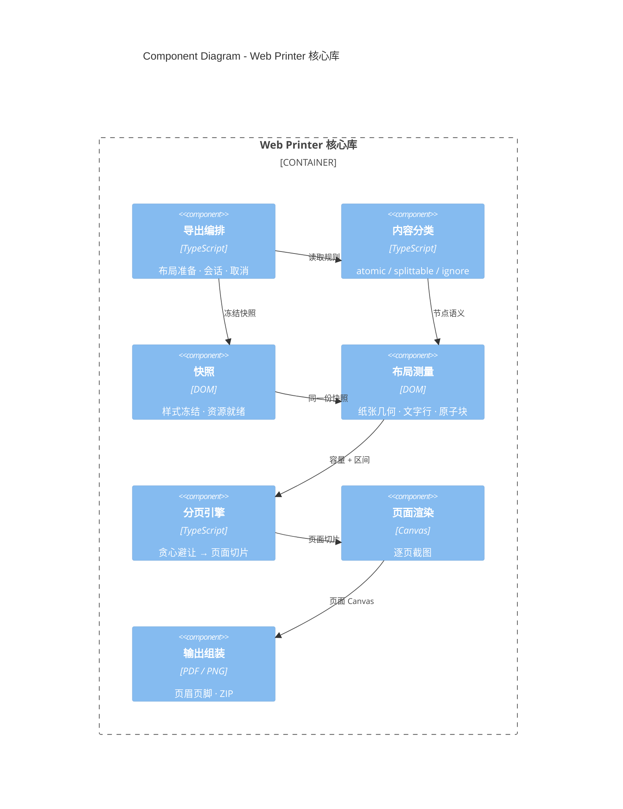

# C4 Component — 核心库

- 受众：修改 `src/lib` 的开发者
- 范围：`@darialan/web-printer` 核心库内部的 7 个组件
- 结论：导出编排只负责流程；内容分析、测量、分页、渲染、输出各自独立，分页引擎是唯一的纯函数核心

> 关系标签保持简短，是为了避免 C4 自动布局把文字压到模块框上；完整语义见下方职责表。

| 组件 | 职责 | 对应代码 |
| --- | --- | --- |
| 导出编排 | 对外 API；准备布局，管理会话、取消与资源释放 | `application/` |
| 内容分类 | 判定 `atomic` / `splittable` / `ignore` | `core/rules/` |
| 快照 | 克隆源 DOM、冻结计算样式、等待字体与图片 | `adapters/dom/snapshot.ts`、`adapters/resources/` |
| 布局测量 | 纸张几何、正文容量、文字行与原子块区间 | `core/geometry/`、`adapters/dom/measurement.ts` |
| 分页引擎 | 纯函数：受保护区间 + 容量 → 页面切片 | `core/pagination/` |
| 页面渲染 | 按切片逐页截图，复用同一份快照 | `adapters/canvas/page-capture.ts` |
| 输出组装 | 页眉页脚与页码 → PDF；逐页 PNG → ZIP | `output/`、`adapters/pdf/` |

## 协作顺序

1. **导出编排**解析打印区域，启动资源等待，创建离屏快照。
2. **内容分类**给出节点语义；**布局测量**在同一份快照上产出受保护区间与容量。
3. **分页引擎**用纯函数算出 `PageSlice[]`，切点穿过保护区时回退。
4. **页面渲染**按切片逐页截图，仍然使用同一份快照。
5. **输出组装**写入页眉页脚、页码，生成 PDF 或 PNG ZIP。

## 外部依赖

- **html2canvas**：由“页面渲染”调用，执行 DOM 截图。
- **jsPDF**：由“输出组装”调用，组装 PDF 页面。
- **Canvas / ZIP**：PNG 模式使用 Canvas 合成整页，ZIP 使用 Store 写入。

## 不变量

- 测量与渲染使用**同一份快照**，从结构上避免“预览能看、导出不一样”。
- `内容分类`、`布局测量`、`分页引擎` 中的计算逻辑不依赖 React；分页引擎可脱离浏览器单测。
- 依赖方向只允许从编排指向分析、渲染、输出；不允许反向 import。
