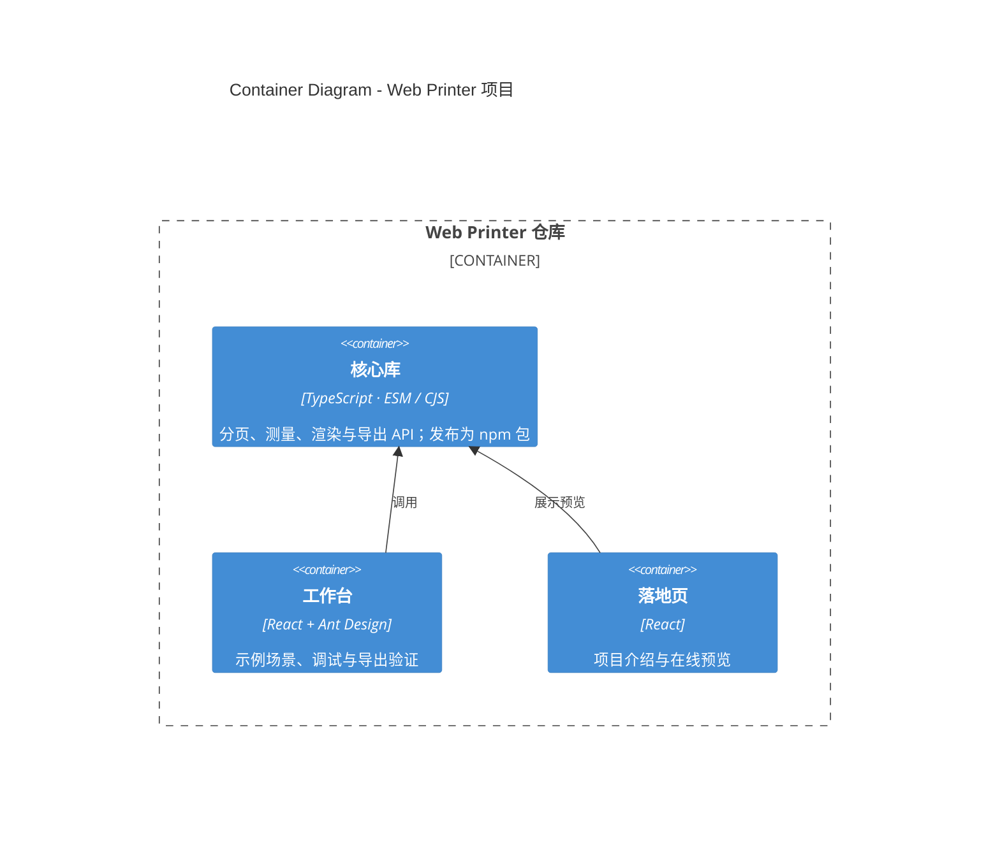

# C4 Container — Web Printer 项目

- 受众：需要理解仓库由哪些可交付单元组成的贡献者
- 范围：仓库内的核心库、工作台、落地页，以及它们之间的依赖关系
- 结论：产品是一个 npm 包；工作台和落地页是仓库内的消费方，不是库的运行时依赖

## 说明

- **核心库**是仓库唯一对外发布的单元，提供根入口和 `/react` 子入口。
- **工作台**是仓库内的完整消费方：切换场景、检查分页、导出 PDF / PNG。
- **落地页**只消费库的分页预览能力，不进入导出主链路。
- 浏览器运行时在 [Context 图](c4-context.md) 中表达；容器图只关注仓库内的可交付单元。
- `html2canvas` 与 `jsPDF` 是核心库的实现依赖，不属于容器，放在[组件视图](c4-components-library.md)说明。

## 关于“库作为容器”

核心库不是独立运行的服务；严格按 C4 定义，它应当被视为宿主应用的组件。这里把它画成容器，是为了在同一张图里表达**发布边界**（npm 包）并允许下一层展开内部组件。在宿主系统语境下，请把它理解为“业务页面这个容器里的一个组件”。

## 边界

- 仓库不包含服务端、数据库或消息队列；所有排版、截图和文件组装都在浏览器内完成。
- 库的运行时依赖只有 `html2canvas` 与 `jsPDF`；React 仅 `/react` 入口使用。
- 工作台和落地页不随 npm 包发布。
