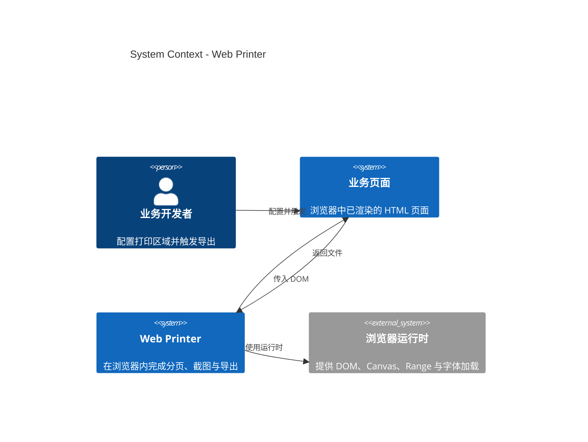

# C4 Context — Web Printer

- 受众：新贡献者、需要判断集成边界的技术负责人
- 范围：一个已渲染的业务页面如何借助 Web Printer 在浏览器内完成分页和导出
- 结论：这是一个**浏览器内的库**，没有服务端；宿主页面负责提供 DOM 和下载动作

## 说明

- **业务页面**是系统边界外的主角：它已经完成业务渲染，库只处理“已经出现在页面上的内容”。
- **Web Printer** 接收 DOM，返回 Blob；下载动作由宿主页面完成，库不依赖任何服务端接口。
- **浏览器运行时**提供库需要的底层能力：DOM 测量、Canvas 2D、Range、Font Loading API。
- `html2canvas` 与 `jsPDF` 是实现依赖，不出现在 Context 图里，放在[组件视图](c4-components-library.md)说明。

## 边界与假设

- 宿主页面与库运行在同一个浏览器上下文；同源 iframe 可以作为打印区域，跨域 iframe 需要宿主自行接入。
- 页面中的图片、字体需要在导出前可访问；跨域图片需要 CORS。
- 输出是光栅 PDF / PNG，不含可搜索文字层；这是当前实现路线的固有结果。
- Shadow DOM、视频、跨域 iframe 不在当前上下文的保证范围内。
