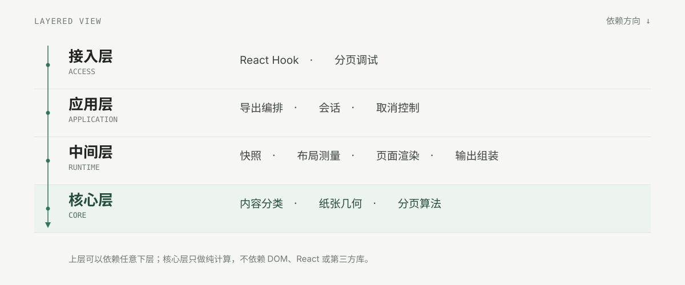

# 分层视图

这是代码分层的补充视角，不是 C4 的第五层。它回答“系统分成哪些层、每层放什么”，C4 文档回答“系统边界、容器和组件如何协作”。

| 层 | 模块 | 职责 |
| --- | --- | --- |
| 接入层 | React Hook · 分页调试 | 对外接入与可视化调试；可选，不进入导出主链路 |
| 应用层 | 导出编排 · 会话 · 取消控制 | 定义阶段顺序、生命周期、取消与资源释放 |
| 中间层 | 快照 · 布局测量 · 页面渲染 · 输出组装 | 把 DOM 冻结成快照，测量并渲染页面切片，组装为 PDF / PNG |
| 核心层 | 内容分类 · 纸张几何 · 分页算法 | 纯计算；不依赖 DOM、React、html2canvas 或 jsPDF |

## 为什么这样分层

- **接入层薄**：只做框架适配和调试标记，换 React / Vue / 原生不触碰下层。
- **应用层只编排**：知道“先快照、再测量、再分页、最后渲染”，但不实现测量和分页。
- **中间层承担 I/O**：唯一接触 DOM、Canvas、html2canvas、jsPDF 的区域。
- **核心层可单测**：纸张几何、保护规则、分页算法都是纯函数，可以在 Node 里精确断言。

依赖只允许向下：接入 → 应用 → 中间 → 核心。`core` 不 import 任何上层或第三方库。上层可以跨层调用更底层的能力，但不会反向依赖。

## 与 C4 的关系

- 分层视图：解释代码组织和依赖方向，适合新贡献者建立地图。
- [C4 Context](c4-context.md)：解释系统在宿主页面、浏览器中的位置。
- [C4 Container](c4-containers.md)：解释仓库里的可发布单元。
- [C4 Component](c4-components-library.md)：解释核心库内部的 7 个组件如何协作。
