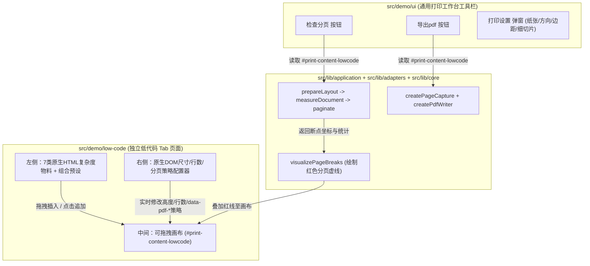

# 复杂页面 PDF 打印系统 技术方案：可视化低代码 DOM 拼装与打印调试平台

> - **状态**：已验收
> - **更新时间**：2026-10-28
> - **涉及范围**：`src/demo/low-code`（新增独立低代码 Tab 页面）、`src/lib/core/rules`（扩展通用降级拆分与忽略属性）、`src/lib/adapters/dom`（剥离编辑态辅助节点）、`src/lib/application`（透出分页诊断指标）、`src/demo/ui`（工作台支持页眉页脚动态挂载与诊断展示）
> - **关联依据**：[通用技术方案设计模板](file:///Users/janicelan/webbbi/mefun/pdf-demo/docs/templates/TECHNICAL-DESIGN-TEMPLATE.md)、[打印模块分层架构说明](file:///Users/janicelan/webbbi/mefun/pdf-demo/docs/printing-modules.md)

**方案摘要**：当前项目已完成 `core`、`adapters`、`application`、`ui`、`demo` 五层架构解耦，但现有 Tab 均为静态写死的页面。本方案属于**已实现并通过自动化验证的设计**：在 `src/demo/` 下新增一个独立的 `low-code`（低代码）Tab 页面，内部提供与具体业务无关、不依赖组件库封装的**原生 HTML/CSS 多复杂度物料库**（多级标题、混合字号富文本段落、原生表格与超高单元格、SVG/Image 媒体图形、CSS Grid/Flex 多列不等高容器、深层嵌套列表/引用块、精确像素定高块）。用户可在该 Tab 中通过拖拽或点击自由组合任意复杂度的 DOM 页面，调节元素像素高度与分页保护策略（整体保护 / 超高自动降级拆分 / 自由拆分），结合现有打印设置执行「检查分页」与「导出 PDF」，直观证明本打印引擎对任意前端复杂 DOM 结构的通用分页能力。

---

## 1. 背景与问题

**核心结论**：现有静态 Tab 示例既无法自由组合未知 DOM 结构，又混杂了特定业务文案与 Ant Design 组件封装，难以直接证明分页引擎对底层原生 HTML/CSS 复杂布局的普适性。

### 1.1 问题与依据

| 编号 | 问题的准确描述 | 事实依据 / 复现路径 | 对用户或系统的影响 |
|---|---|---|---|
| P1 | 现有 Demo Tab 页面结构固定，用户无法在界面上自由拖拽、增删或重排 DOM 元素来验证任意组合下的分页表现。 | [src/demo/index.tsx](file:///Users/janicelan/webbbi/mefun/pdf-demo/src/demo/index.tsx#L11-L26) 中的 8 个 Tab 均为固定 JSX 结构，无法动态调整节点顺序。 | 外部评审者容易误以为分页仅针对固定页面做过特殊适配，无法交互式验证任意未知布局。 |
| P2 | 现有示例大量使用业务单据概念及 Ant Design 组件（如 `Table`、`Card`、`Descriptions`），缺少纯粹针对不同 HTML 标签复杂度（原生表格、Grid/Flex 多列、内联混排、SVG/Img、深层嵌套）的无业务属性测试物料。 | 现有 `purchase-order`、`single-page` 等页面强耦合茶饮采购业务字段与 Ant Design 组件样式。 | 无法直观展示引擎底层基于原生 DOM 几何测量与 CSS 选择器规则（`tr`、`img/svg/canvas`、`h1~h6`、文本 `Range`）的跨框架通用能力。 |
| P3 | 缺少针对单个 HTML 结构的“几何尺寸（高度/行数）”与“分页保护策略”实时调节面板，难以快速构造压线 1px、超高容器降级拆分、超高原子块报错等极端临界场景。 | [print-rules.ts](file:///Users/janicelan/webbbi/mefun/pdf-demo/src/lib/core/rules/print-rules.ts#L13-L20) 支持属性驱动规则，但前端无可视化滑块或策略切换器。 | 复现跨页临界碰撞或验证超高报错提示需要手工改代码调样式，调试效率低。 |
| P4 | 低代码画布中的编辑态辅助控件（拖拽手柄、选中高亮框、上移/下移/删除按钮）若进入打印快照，会干扰高度测量并残留到导出 PDF 中。 | [snapshot.ts](file:///Users/janicelan/webbbi/mefun/pdf-demo/src/lib/adapters/dom/snapshot.ts#L56) 目前仅移除 `[data-pdf-debug]` 节点，未过滤低代码编辑器操作浮层。 | 若不隔离编辑态控件，画布测量高度将偏离真实内容高度，且 PDF 中会截入操作按钮。 |

### 1.2 核心概念与改动边界

**核心结论**：新增的 `low-code` Tab 作为 `src/demo/` 下的一个独立页面目录，内部输出纯正的原生 HTML/CSS 节点与 `data-pdf-*` 标记，直接复用现有 `ui` 工具栏与 `application -> adapters + core` 打印流水线。

- **术语定义**：
  - **原生复杂度物料（Native HTML Complexity Material）**：不带任何业务含义、使用原生 HTML5 标签（`section`、`table/tr/td`、`p/span/sup/code`、`figure/svg/img`、`blockquote/ul/li`）和标准 CSS（Flexbox、Grid、多行高）构建的可配置 DOM 模板。
  - **分页保护策略（Pagination Policy）**：决定物料块在跨页边界处的处理方式，映射为根节点上的 `data-pdf-*` 属性：
    1. `default`（遵循标签默认规则）：不额外加容器级强制属性，由引擎按内部 `h1~h6`、`tr`、`img/svg`、文本行默认规则自动处理。
    2. `keep-together`（强制整体保护，超高报错）：挂载 `data-pdf-keep-together="true"`，跨页时整块移至下一页，单页放不下时明确报错。
    3. `keep-or-split`（优先整体保护，超高自动拆分）：挂载 `data-pdf-keep-together="split"`，放得下时整块换页，超过单页容量时自动降级遍历内部子节点按行拆分。
    4. `force-split`（强制自由拆分）：挂载 `data-pdf-break="split"`，作为普通容器进入内部按文本行或子元素拆分。
  - **编辑态忽略标记（`data-pdf-ignore="true"`）**：挂载在画布拖拽手柄、块操作工具栏、空画布提示上的 HTML 属性，在 DOM 测量遍历与离屏快照克隆时被完全忽略并移除。
- **改动层级**：
  - **`src/lib/core/rules/`**：在 [print-rules.ts](file:///Users/janicelan/webbbi/mefun/pdf-demo/src/lib/core/rules/print-rules.ts) 的忽略选择器中加入 `[data-pdf-ignore="true"]`，并新增 `[data-pdf-keep-together="split"]`（映射为 `{ kind: 'atomic', overflow: 'split' }`）。
  - **`src/lib/adapters/dom/`**：在 [snapshot.ts](file:///Users/janicelan/webbbi/mefun/pdf-demo/src/lib/adapters/dom/snapshot.ts) 克隆时一并清理 `[data-pdf-ignore="true"]` 节点。
  - **`src/lib/application/`**：在 [print-service.ts](file:///Users/janicelan/webbbi/mefun/pdf-demo/src/lib/application/print-service.ts) 新增 `inspectPrintLayout` 返回测量统计（遍历节点数、原子块数、文本片段数、保护区间数）与耗时明细。
  - **`src/demo/low-code/`**：新增独立的低代码 Tab 页面目录，遵循“一个 Tab 一个独立目录维护自身代码”的原则，内含左侧原生 HTML 物料面板、中间可拖拽画布（挂载 `#print-content-lowcode`）、右侧选中块属性编辑器与实时分页诊断卡片。
  - **`src/demo/index.tsx`**：在 `DEMO_SCENES` 中注册 `低代码` Tab。

---

## 2. 目标与范围

**核心结论**：在 `低代码` Tab 内提供 7 类不同结构复杂度的原生 HTML 物料与自由拖拽画布，让用户无需编写代码即可组合任意复杂 DOM 页面，并直接通过顶部「打印设置 / 检查分页 / 导出pdf」完成全流程验证。

### 2.1 核心目标

| 编号 | 目标描述 | 对应问题 | 用户或系统可观察/可度量的结果 |
|---|---|---|---|
| G1 | 在 `src/demo/low-code/` 下实现独立的「低代码」Tab 页面，支持从左侧拖拽或点击追加物料到画布、拖拽重排顺序、上下移动、复制、删除及一键加载复杂组合预设。 | P1 | 切换到「低代码」Tab 后，用户可通过拖拽自由编排画布节点顺序，且所有编排状态自动持久化至 `localStorage`。 |
| G2 | 设计 7 类去业务化、纯原生 HTML/CSS 的不同复杂度物料，全面覆盖内联多字号混排、原生表格与超高行、SVG/图形媒体、CSS Grid/Flex 多列不等高布局、深层嵌套列表引用及精确像素定高块。 | P2 | 画布打印区域（`#print-content-lowcode`）内部全部由原生 HTML 标签渲染，不依赖 Ant Design 布局组件，直观体现引擎对底层 DOM 的普适性。 |
| G3 | 提供右侧物料属性与分页策略面板，支持实时调节每个物料块的尺寸/数量参数（像素高度、行数、列数、段落数、字号行高）及 4 种分页保护策略，并实时展示引擎测量统计。 | P3 | 修改任意块高度或分页策略后，点击顶部「检查分页」，画布立即绘制准确的红色分页虚线，并在低代码诊断栏展示遍历节点数、保护区间数与分阶段耗时。 |
| G4 | 确保画布编辑器的选中框、拖拽手柄、删除按钮与打印 DOM 严格隔离，不占用垂直流高度，也不出现在导出 PDF 中。 | P4 | 编辑态工具条统一使用绝对定位浮层 + `data-pdf-ignore="true"`，分页检查零穿刺误报，导出 PDF 纯净无编辑器残留。 |

### 2.2 范围边界与依赖

- **本期包含（In Scope）**：
  - 新增 `src/demo/low-code/index.tsx` 并注册为顶层 Tab（`低代码`）。
  - 7 类原生 HTML/CSS 复杂度物料：
    1. **多级标题与导语块（`<header> + <h1>~<h3>`）**：验证标题原子保护。
    2. **多字号中英混排段落（`<p> + <span> + <sup> + <code>`）**：验证同一行内不同字号、上下标、行高下的文本 `Range` 行盒退让。
    3. **原生 HTML 表格（`<table> + <thead> + <tbody> + <tr> + <td>`）**：支持调节普通行数，并可开启“单行超长多段文本单元格”，验证普通 `tr` 整行换页与超高 `tr` 自动降级按行拆分。
    4. **原生图形与媒体块（`<figure> + <svg> + <figcaption>`）**：支持调节图形像素高度（`60px ~ 1400px`）与并排数量，验证媒体不可拆分保护及超页高报错。
    5. **CSS Grid 多列不等高卡片容器（`<div style="display:grid">`）**：支持 2~3 列不等高内容并排，验证并排复杂盒子在整体保护与自由拆分下的跨页表现。
    6. **深层嵌套引用与列表容器（`<section> + <blockquote> + <ul>/<li>`）**：支持调节嵌套深度与列表项数，验证显式栈深度优先遍历。
    7. **精确像素定高刻度块（`<div style="height: Npx">`）**：支持 `10px ~ 1500px` 像素级微调，用于将后续元素精确推至分页线临界点。
  - 画布内自定义页眉（`#print-header-lowcode`）与页脚（`#print-footer-lowcode`）开关与文本编辑。
- **本期不包含（Out of Scope）**：
  - 不改动其他已有的 7 个独立 Tab 页面内部代码。
  - 不引入第三方拖拽库或低代码运行时依赖，保持纯原生 React + HTML5 Drag & Drop 实现。

---

## 3. 现状分析

**核心结论**：现有五层架构已将 UI 工作台（`src/demo/ui`）与示例页面（`src/demo`）彻底解耦，只需对 `core/rules`、`adapters/dom/snapshot` 与 `application/print-service` 做向后兼容的小幅增强，即可在 `src/demo/low-code/` 中完整承载低代码拼装台。

| 当前模块 / 源码入口 | 当前职责 | 已核对的现状与限制 | 本期处理策略（沿用 / 改造 / 废弃替换） |
|---|---|---|---|
| [src/lib/core/rules/print-rules.ts](file:///Users/janicelan/webbbi/mefun/pdf-demo/src/lib/core/rules/print-rules.ts) | 维护 `DEFAULT_PRINT_RULES` 与 `classifyPrintNode` | 已支持 `[data-pdf-keep-together="true"]` 与 `[data-pdf-break="split"]`，尚未内置 `[data-pdf-ignore="true"]` 和 `[data-pdf-keep-together="split"]`。 | **轻量扩展**：新增上述两条通用选择器规则，保持零 DOM 依赖。 |
| [src/lib/adapters/dom/snapshot.ts](file:///Users/janicelan/webbbi/mefun/pdf-demo/src/lib/adapters/dom/snapshot.ts) | 创建离屏打印快照并移除 `[data-pdf-debug]` | 仅移除 `[data-pdf-debug]`，尚未移除 `[data-pdf-ignore="true"]`。 | **轻量扩展**：克隆后一并移除 `[data-pdf-ignore="true"]` 节点。 |
| [src/lib/application/print-service.ts](file:///Users/janicelan/webbbi/mefun/pdf-demo/src/lib/application/print-service.ts) | 提供 `outputPDF` 与 `calculatePagesArray` | `calculatePagesArray` 仅返回页起点数组，未返回测量统计 `stats` 与耗时。 | **兼容扩展**：新增 `inspectPrintLayout` 返回完整诊断信息，并派发自定义诊断事件或回调供工作台与低代码面板消费。 |
| [src/demo/ui/print-workbench.tsx](file:///Users/janicelan/webbbi/mefun/pdf-demo/src/demo/ui/print-workbench.tsx) | 渲染顶部操作栏与 Tabs | 已支持按每个 Scene 的 `contentId`、`headerId`、`footerId` 动态查找 DOM 节点。 | **沿用并增强**：将最新一次 `inspectPrintLayout` 的诊断摘要透出到状态栏。 |
| [src/demo/index.tsx](file:///Users/janicelan/webbbi/mefun/pdf-demo/src/demo/index.tsx) | 汇总各独立 Tab 页面 | 当前包含 8 个静态 Tab。 | **扩展**：新增第 1 个（或排在首位/末位的）`低代码` Tab，指向 `src/demo/low-code/index.tsx`。 |

---

## 4. 概要设计

**核心结论**：`src/demo/low-code/` 内部采用“左侧原生 HTML 物料库 + 中间流式拖拽画布（`#print-content-lowcode`）+ 右侧 DOM 属性与分页策略调节器”三栏布局，顶部直接复用全局「导出pdf / 检查分页 / 打印设置」工具栏。

### 4.1 模块与对象职责划分

| 对象 / 模块 / 组件 | 所在层级与类型 | 执行模式 / 核心机制 | 输入 → 输出契约 | 状态归属与读写权限 |
|---|---|---|---|---|
| `DEFAULT_PRINT_RULES` | [src/lib/core/rules/print-rules.ts](file:///Users/janicelan/webbbi/mefun/pdf-demo/src/lib/core/rules/print-rules.ts)（核心计算层） | 声明式选择器优先级匹配 | `ClassifiableNode` → `ElementRule` | 纯常量与纯函数，无状态 |
| `inspectPrintLayout` | [src/lib/application/print-service.ts](file:///Users/janicelan/webbbi/mefun/pdf-demo/src/lib/application/print-service.ts)（应用编排层） | 异步流水线编排 | `PreviewPaginationOptions` → `PrintInspectionResult` | 管理单次快照生命周期，向调用方返回分页断点与统计数据 |
| `LowCodePage` | `src/demo/low-code/index.tsx`（示例层独立 Tab 页面） | React 受控画布 + 原生 Drag & Drop | 用户拖拽/属性变更 → 渲染 `#print-content-lowcode` 原生 HTML DOM 树 | 独立维护画布块列表 `blocks`、选中块 `selectedId` 及页眉页脚配置 |

### 4.2 架构与关键流程



### 4.3 关键技术决策与外部参考

| 决策点 | 采用方案 | 备选方案 | 采用原因与代价（Trade-offs） |
|---|---|---|---|
| 画布内物料的渲染实现 | 100% 使用原生 HTML 标签（`table`, `figure`, `svg`, `blockquote`, `p`, `div`）与内联/局部标准 CSS | 使用 Ant Design `Table`、`Card` 等组件渲染物料 | 用户明确要求物料与业务无关且体现底层 HTML 复杂元素；原生 HTML 标签直接对应 `core/rules` 中的 `tr`、`img/svg`、`h1~h6`、文本节点规则，最具技术说服力。 |
| 低代码模块的代码组织位置 | 全部收敛在 `src/demo/low-code/` 独立目录下 | 散落在 `src/demo/ui/`、`src/demo/` 多个子文件夹中 | 严格遵循前序确立的“一个 Tab 就是一个独立页面文件夹维护自身代码”原则，保持目录极简清晰。 |

---

## 5. 详细设计

### 5.1 通用业务与技术规则

| 规则编号 | 前置条件 / 触发时机 | 核心行为与不变量（Invariants） | 边界情况 / 空结果 / 冲突与异常处理 |
|---|---|---|---|
| R1（原生 HTML 物料分页策略映射） | 画布渲染任意物料块时 | 根据块配置的 `policy` 写入根容器属性：<br>- `default`：不挂载容器级强制属性，交由内部原生标签（`h1~h6`、`tr`、`svg`、文本节点）按默认规则处理；<br>- `keep-together`：挂载 `data-pdf-keep-together="true"` 与 `data-pdf-label`；<br>- `keep-or-split`：挂载 `data-pdf-keep-together="split"`；<br>- `force-split`：挂载 `data-pdf-break="split"`。 | 当块策略为 `keep-together`（或内部含超高的 `svg/img`）且像素高度大于单页 `capacity` 时，执行分页检查或导出必须准确抛出带 `label` 和像素高度的错误提示。 |
| R2（编辑态悬浮层零干扰规则） | 画布块处于选中或悬停编辑状态时 | 块的拖拽条、上移/下移/复制/删除按钮、策略角标统一放在 `position: absolute` 且带 `data-pdf-ignore="true"` 的悬浮节点内；选中态使用 `outline` 而非 `border` 或 `margin`。 | 切换选中块或悬停状态不会引起文档流任何 `1px` 的高度变化；离屏快照与测量遍历完全跳过 `[data-pdf-ignore="true"]`。 |
| R3（画布变更自动清理旧分页线） | 用户在低代码画布中拖拽排序、增删物料、修改右侧参数或切换预设组合时 | 立即调用 `clearPageBreaks()` 清除画布上残留的红色分页虚线，避免 DOM 高度变化后旧虚线位置失真。 | 若画布被清空（`blocks.length === 0`），画布内显示带 `data-pdf-ignore="true"` 的空状态拖拽引导提示；此时点击检查分页提示打印区域为空。 |
| R4（动态页眉页脚槽位联动） | 用户在低代码右侧面板开启/关闭画布页眉或页脚时 | 开启时渲染 `#print-header-lowcode` / `#print-footer-lowcode` DOM 节点，关闭时不渲染（`document.getElementById` 返回 `null`），`PrintWorkbench` 自动按实际存在性传入 `prepareLayout`。 | 在细切片测试模式（`slicingMode: true`）下，引擎自动忽略页眉页脚并按纯高度切片。 |

### 5.2 接口契约与外部集成（API / 协议 / 第三方 / AI）

```ts
// src/demo/low-code/index.tsx 内部物料与画布数据结构
export type HtmlMaterialType =
  | 'heading-block'      // 原生标题组 (h1~h3 + 导语)
  | 'mixed-paragraph'    // 多字号/上下标/行内代码混排段落 (p + span + sup + code)
  | 'native-table'       // 原生 HTML 表格 (table + thead + tbody + tr + 可选超长单元格)
  | 'media-figure'       // 原生图形媒体块 (figure + svg + figcaption)
  | 'grid-cards'         // CSS Grid 多列不等高容器 (div[display:grid])
  | 'nested-list-quote'  // 深层嵌套引用与列表 (section + blockquote + ul/li)
  | 'height-spacer';     // 精确像素定高刻度块 (div[height: Npx])

export type BlockPolicy = 'default' | 'keep-together' | 'keep-or-split' | 'force-split';

export interface LowCodeBlock {
  id: string;
  type: HtmlMaterialType;
  label: string;
  policy: BlockPolicy;
  // 参数化控制维度（按类型启用对应字段）
  heightPx?: number;        // 用于 height-spacer / media-figure
  rowCount?: number;        // 用于 native-table
  oversizedRowLines?: number; // 用于 native-table 超长单元格内部段落数 (0 表示无超长行)
  paragraphCount?: number;  // 用于 mixed-paragraph
  lineHeight?: number;      // 用于 mixed-paragraph
  columns?: number;         // 用于 grid-cards / media-figure
  itemCount?: number;       // 用于 nested-list-quote / grid-cards
  headingLevel?: 1 | 2 | 3; // 用于 heading-block
}
```

### 5.3 核心算法与执行流程

```ts
// 伪代码，用于表达逻辑边界：物料块属性到 DOM data-pdf-* 的映射与测量隔离
function resolvePolicyAttributes(block: LowCodeBlock): Record<string, string | undefined> {
  if (block.policy === 'keep-together') {
    return { 'data-pdf-keep-together': 'true', 'data-pdf-label': block.label };
  }
  if (block.policy === 'keep-or-split') {
    return { 'data-pdf-keep-together': 'split', 'data-pdf-label': block.label };
  }
  if (block.policy === 'force-split') {
    return { 'data-pdf-break': 'split' };
  }
  return {};
}
```

### 5.4 数据模型与存储设计

| 表 / 集合 / 缓存 / 状态对象 | 主键、外键、核心字段与类型 | 唯一约束、索引与隔离维度 | 变更类型（新增 / 扩容 / 迁移 / 复用） |
|---|---|---|---|
| `localStorage['pdf_demo_lowcode_v1']` | `headerEnabled: boolean`, `headerText: string`, `footerEnabled: boolean`, `footerText: string`, `blocks: LowCodeBlock[]` | 浏览器本地同源存储 | **新增**：保存用户在「低代码」Tab 编排的 DOM 块序列，异常时自动回退至默认综合复杂度模板。 |

### 5.5 状态机、并发控制与异常恢复

| 状态拥有者（唯一写入方） | 触发事件 | 当前状态与前置校验 | 下一状态 | 持久化与外部副作用 |
|---|---|---|---|---|
| `LowCodePage` | 拖入物料 / 拖拽排序 / 修改块参数 / 切换预设 | 非导出执行态 | 画布已更新（待检查） | 写入 `localStorage`；自动调用 `clearPageBreaks()` 移除过期红线 |
| `PrintWorkbench` | 点击「检查分页」 | 画布含至少 1 个有效物料块 | 分页预览态 | 调用 `inspectPrintLayout`；在 `#print-content-lowcode` 绘制红色虚线；状态栏显示页数、保护区间数与耗时 |
| `PrintWorkbench` | 点击「导出pdf」 | 画布含至少 1 个有效物料块 | 导出执行态 → 完成态 | 调用 `outputPDF` 按页截图并下载 PDF；`finally` 释放 Canvas 与离屏快照 |

### 5.6 性能、成本、可观测性与安全隐私

- **性能开销**：7 类物料全部使用原生 HTML 与内联 SVG 渲染，不发起任何网络请求，单次增删改重绘耗时 `< 5ms`。
- **可观测性增强**：`PrintWorkbench` 状态栏在「检查分页」后展示：`分页检查：N 页 · 保护区间 M 个 · 测量 X.Xms / 分页 Y.Yms`，让用户调整低代码物料复杂度时能直接观测到保护区间数量与耗时的变化。

### 5.7 规则验证示例（Examples）

**示例 E1：在「低代码」Tab 验证原生表格、定高块与图形媒体的跨页行为**

| 场景类型 | 输入条件 / 初始状态 | 预期输出 / 最终状态 | 对应规则编号 |
|---|---|---|---|
| 正常场景（定高块推挤 + 图形整体换页） | 在画布放置 `950px` 定高块 + `260px` 原生图形块（`<figure><svg>`），点击「检查分页」。 | 第 1 页在 `950px` 处断开，图形块完整落入第 2 页，红线不穿过图形。 | R1, R2 |
| 边界场景（原生表格含单行 40 段超长单元格） | 在画布放置「原生 HTML 表格」，开启“包含超长单元格（40 段）”，点击「检查分页」。 | 普通行保持整行不拆；超长行因高度超过单页 `capacity`，自动触发 `tr` 的 `overflow: 'split'` 规则降级进入单元格内部按文字行安全分页。 | R1 |
| 异常反例（强制整体保护块超高报错） | 选中「CSS Grid 多列容器」或「原生图形块」，将策略设为 `keep-together` 且高度调至 `1300px`，点击「检查分页」。 | 状态栏与提示框准确报错：`不可拆分区域「...」高 1300px，超过正文可用高度 ...px，请缩小该区域或增大页面高度`。 | R1 |

---

## 6. 实施与发布计划

### 6.1 分阶段交付

| 阶段 | 代码 / 配置 / 数据落点 | 阶段交付物 | 进入下一阶段的准入门槛 |
|---|---|---|---|
| 阶段 1：核心规则与诊断服务增强 | [src/lib/core/rules/print-rules.ts](file:///Users/janicelan/webbbi/mefun/pdf-demo/src/lib/core/rules/print-rules.ts)、[src/lib/adapters/dom/snapshot.ts](file:///Users/janicelan/webbbi/mefun/pdf-demo/src/lib/adapters/dom/snapshot.ts)、[src/lib/application/print-service.ts](file:///Users/janicelan/webbbi/mefun/pdf-demo/src/lib/application/print-service.ts) | 支持 `[data-pdf-ignore="true"]` 与 `[data-pdf-keep-together="split"]`；新增 `inspectPrintLayout`。 | 单元测试覆盖并通过。 |
| 阶段 2：独立「低代码」Tab 页面实现 | `src/demo/low-code/index.tsx`、[src/demo/index.tsx](file:///Users/janicelan/webbbi/mefun/pdf-demo/src/demo/index.tsx)、[src/demo/ui/print-workbench.tsx](file:///Users/janicelan/webbbi/mefun/pdf-demo/src/demo/ui/print-workbench.tsx) | 7 类原生 HTML 物料拖拽/追加、画布重排、右侧参数与分页策略调节器、预设复杂度模板切换。 | 组件集成测试与全量构建通过。 |

### 6.2 发布、兼容、灰度和回滚方案

- **兼容策略**：保留原有全部 Tab 页面不变，新增 `低代码` Tab 作为独立模块挂载在 `src/demo/low-code/` 下。
- **应急回滚**：若需回滚，仅需在 [src/demo/index.tsx](file:///Users/janicelan/webbbi/mefun/pdf-demo/src/demo/index.tsx) 移除 `低代码` Tab 项并删除 `src/demo/low-code/` 目录。

### 6.3 待决事项（Open Questions）

| 编号 | 待决问题描述 | 潜在影响范围 | 候选方案 / 验证方式 | 责任人与决策期限 |
|---|---|---|---|---|
| 无 | 用户已明确：新增独立「低代码」Tab，且左侧物料采用与业务无关的各复杂度原生 HTML 元素。 | `src/demo/low-code/` | 已确认，直接按本方案实施。 | 已完成决策 |

---

## 7. 验收标准

### 7.1 需求与设计追踪矩阵

| 问题 → 目标 | 对应规则 / 章节 | 验收测试场景 | 通过标准（可观察/可度量） | 实际验证结果 |
|---|---|---|---|---|
| P1 → G1 | R3, R4 / §5.1 | 切换至「低代码」Tab，从左侧拖入/点击添加物料、调整顺序、复制、删除、切换预设组合 | 画布 `#print-content-lowcode` 节点顺序实时更新，每次变更自动清理过期红线 | 待执行 |
| P2 → G2 | R1 / §2.2, §5.2 | 分别添加 7 类原生 HTML 物料（标题、混排段落、原生表格、SVG 媒体、Grid 多列、嵌套列表引用、像素定高块） | 全部渲染为原生 HTML 标签结构，无业务耦合字段，支持分页检查与 PDF 导出 | 待执行 |
| P3 → G3 | R1 / §5.1, §5.7 | 在右侧面板调节块高度/行数/列数及切换 4 种分页策略（默认/整体保护/超高拆分/自由拆分） | DOM `data-pdf-*` 属性实时同步；超高不可拆块准确报错，超高可降级块按行安全拆分 | 待执行 |
| P4 → G4 | R2 / §5.1, §5.3 | 画布含选中块及编辑操作条时执行「检查分页」 | `[data-pdf-ignore="true"]` 节点被完全忽略，`validatePageBreaks` 零穿刺报错 | 待执行 |

### 7.2 测试与验证分层

1. **确定性自动化测试**：在 `measurement.test.ts`、`print-service.test.ts` 与 `App.test.tsx` 中补充针对 `[data-pdf-ignore="true"]`、`[data-pdf-keep-together="split"]`、`inspectPrintLayout` 及「低代码」Tab 交互的自动化测试。
2. **构建与类型验证**：执行 `tsc --noEmit`、`CI=true npm test -- --watchAll=false --runInBand` 与 `npm run build`。

### 7.3 影响面核查与完成定义（Definition of Done）

| 运行环境 / 终端 / 下游调用方 | 是否受影响 | 验证入口 / 执行命令 | 验证重点 | 当前状态 |
|---|---|---|---|---|
| 核心规则与 DOM 测量层 (`src/lib/core`, `src/lib/adapters`) | 受影响（新增 2 条属性规则） | `npm test` | `[data-pdf-ignore="true"]` 跳过测量、`[data-pdf-keep-together="split"]` 超高自动降级 | 已通过（`src/lib/core/rules/print-rules.test.ts`、`src/lib/adapters/dom/snapshot.test.ts`） |
| Web 工作台与低代码 Tab (`src/demo/ui`, `src/demo/low-code`) | 受影响（新增 `低代码` Tab） | `npm test` & `npm run build` | 7 类原生 HTML 物料编排、属性修改、分页检查与导出全链路正常 | 已通过（`src/App.test.tsx` 覆盖物料添加、保护策略切换与宽度调整；构建编译成功） |

**本期完成门槛（DoD）**：
- [x] 完成阶段 1 与阶段 2 全部代码实现
- [x] §7.1 追踪矩阵中的所有场景自动化测试通过（`CI=true npm run test:once`：14 套 / 44 用例全部通过）
- [x] `tsc --noEmit`、`npm test`、`npm run build` 零错误通过
