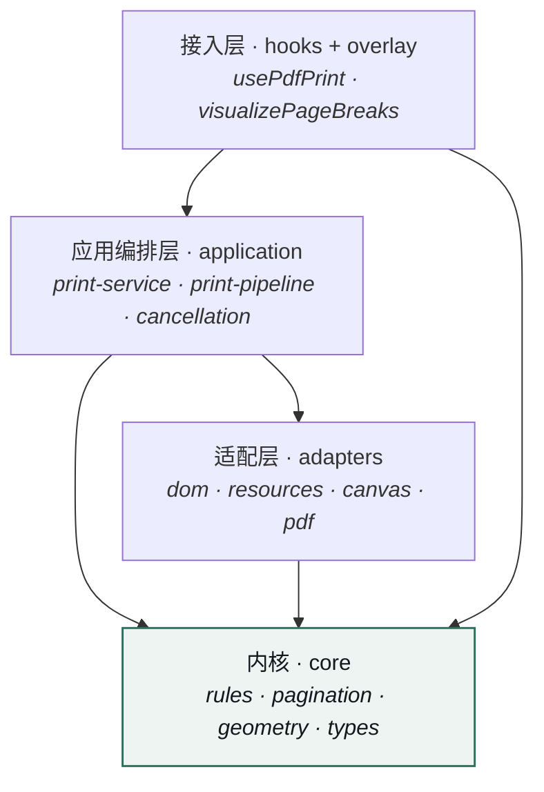
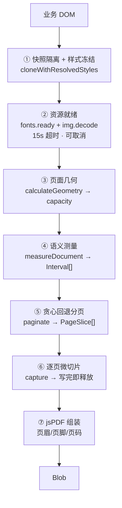
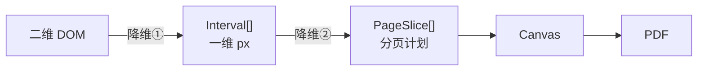

# @darialan/web-pdf-printer · 实现速览

> 客户端 DOM 分页与 PDF 导出引擎。**把浏览器排版结果重新解释成一份可计算的分页计划。**

---

## 本质

```
DOM ──降维──> 区间数组 ──纯函数──> 分页计划 ──执行──> PDF
   (二维/样式)   (一维/px)      (纯算法)        (切片渲染)
```

真正被导出的是**分页计划**，不是 DOM。渲染层只负责忠实执行算好的切法。

---

## 1. 架构：五层单向依赖



| 层 | 职责 | 铁律 |
|---|---|---|
| `core` | 怎么算 | **零 DOM、零第三方**，import 只指向 `core/types` → 纯函数可脱离浏览器单测 |
| `adapters` | 对接浏览器 | 唯一接触 `document` / `html2canvas` / `jspdf` 的地方，全部工厂函数可替换 |
| `application` | 什么时候算 | 唯一定义**阶段顺序**与资源释放的地方 |
| `hooks` / `overlay` | 接入与可观测 | React 状态机 + 原生 DOM 调试层 |

> core 是纯叶子，依赖方向永不反转。改分页策略只动 core，不动上层。

---

## 2. 核心流程：六阶段



**顺序不可交换**：② 必须在 ④ 前（字体没就绪量出的行高是错的）；④ 必须在 ⑤ 前（没有保护区无从避让）。

**同一份快照贯穿 ④ 与 ⑥** —— 测量对象 === 渲染对象，从结构上消灭"预览能看、导出不一样"。

---

## 3. 三个关键机制

### 3.1 快照冻结：为什么不用原 DOM 测


> **细节**：冻结计算样式时**跳过 width/height**。computed width 是"使用值"，把它写死等于把 `auto` 改成定值，会破坏外边距合并与表格对齐。

### 3.2 贪心回退避让：整个库技术含量最高的一段

```
        ┌─────────────────┐
        │ 表格第 1 行     │ atomic [118,170]
        ├─────────────────┤
  页 1  │ 表格第 2 行     │ atomic [170,222]  ← 跨页
        ├─────────────────┤
        │                 │
 ─ ─ ─ ─┼─ ─ ─ ─ ─ ─ ─ ─ ┼ ─ ─  初始切点 = start+capacity  ✂ 腰斩
        │                 │
        └─────────────────┘
                          ↑ 回退到 222 的顶部 → 第 2 行整块下移
```

```ts
// core/pagination/paginator.ts —— 纯函数，输入数值输出切片
if (range.top < end && range.bottom > end) next = Math.min(next, range.top);
```

- 切点穿过受保护区 → **回退到该元素顶部**
- 新切点仍相交 → 继续回退，直到落在空白缝隙
- 保护区高于整页 → **显式抛错**，不静默腰斩

> **表格行不腰斩不是特判**：`<tr>` 天然命中 atomic 规则，是算法自然结果。

### 3.3 按页微切片：为什么不能整页截图

```
❌ 整页截图   20000px × 800px × scale2 = 5120万像素  →  Canvas OOM
✅ 按页切片   单页 ≈ 800×1100×scale2 = 176万像素     →  峰值与总页数无关
```

每页写入 PDF 后立即 `canvas.width = 0; canvas.height = 0` 释放显存，不等 GC。
配套：8M 像素预算预检、scale 自适应封顶 2 / 下限 0.5、每页 `setTimeout(0)` 让出主线程。

---

## 4. 数据流：两次降维

| 阶段 | 输出 | 单位 / 坐标系 |
|---|---|---|
| 测量 `measureDocument` | `Interval[] {top,bottom}` | CSS px，相对**快照根顶部** |
| 分页 `paginate` | `PageSlice[] {start,end}` | CSS px，无空洞无重叠 |
| 几何 `calculateGeometry` | `PageGeometry` | **pt 纸张坐标** + `ratio` |
| 渲染 `capture` | `HTMLCanvasElement` | 单页微片 |
| 组装 `addPageSlice` | PDF 页 | px × `ratio` → pt |



> **pt ↔ px 全链路只经 `ratio` 一个因子**（`contentWidth / width`），所以坐标永不漂移。

### 三种语义分工

| 规则 | 行为 |
|---|---|
| `ignore` | 不测量、不渲染 |
| `atomic` | 注册为**受保护区**。放不下整块下移；`overflow:'error'` 超高报错，`'split'` 允许下沉拆分 |
| `container` | 不注册区间，**继续向内遍历** |
| `text` | `Range.getClientRects()` 拆成**逐行**区间 |

---

## 5. 扩展点（4 层）

| 层级 | 入口 | 适用 |
|---|---|---|
| 声明式 | `data-pdf-atomic` / `-splittable` / `-ignore`（含类名别名） | 业务方最常用，零配置 |
| 配置化 | `PrintRuleConfig { atomic, splittable, ignore, customRules }` | `customRules` **前置优先**，可覆盖 `tr`/`h1~h6` 默认行为 |
| 全局注册 | `configurePrint()` / `getPrintRules()` / `resetPrintRules()` | 多技术栈适配（`.el-table__row` 等） |
| 单次覆盖 | `rules` / `ruleConfig` 参数 | 同页多套规则，**不污染全局** |
| 适配器替换 | `createPageCapture` / `createPdfWriter` / `createPrintSnapshot` | 换渲染器/换 PDF 库，上层不动 |

```ts
// 业务侧只需加属性
<div data-pdf-atomic="true">签字盖章栏</div>
<tr>...</tr>                    // tr 默认 atomic
<button data-pdf-ignore="true">导出</button>
```

---

## 6. 硬边界（面试主动说，加分）

- **光栅 PDF**：文字不可搜索、不可复制，体积偏大 —— html2canvas 路线的固有代价
- **不支持**跨页 `rowspan`、不自动重复表头
- **行高为近似**：`getClientRects()` + leading 估算，非完整 CSS line-box 重建（混合字体有偏差）
- **贪心不求页数最优**，保护区密集时可能多出空白页
- **全局状态**：`configurePrint()` 是模块级变量，多配置场景需用局部 `rules` 规避
- **缺**浏览器端到端导出测试、PDF 产物视觉比对、内存基准

> 库的应对方式：**用错误把边界显性化**——超高原子块、边距占满、图片加载失败全部显式抛错并给出可操作提示。

---

## 附：工程机制速查

| 机制 | 实现 |
|---|---|
| 遍历 | 显式栈 DFS，绕开 JS 调用栈上限（旧实现 20,000px 崩溃的根因） |
| 行高缓存 | `WeakMap` 缓存父元素 `lineHeight` |
| 跨 realm | `isPrintableElement()` duck-typing，支持 iframe 内元素 |
| 并发锁 | `WeakSet` 阻止同一区域重复导出 |
| 取消 | `AbortSignal`，7 个检查点，分配快照**前**即检查 |
| 清理 | 快照 / Canvas / 调试图层三层释放，全部挂 `finally` |
| 一致性校验 | 预览用**同一套** `prepareLayout`，再回源 DOM 复测并 `validatePageBreaks`（0.25px 容差） |
| 资源预算 | 高度 200,000px · 字符 200,000 · 页数 100 · 像素 8M · 超时 15s |

**测试分层**：core 纯函数可在 Node 精确断言（切片边界到小数点）→ adapters 测 DOM 行为 → application 测编排（mock 依赖）。
